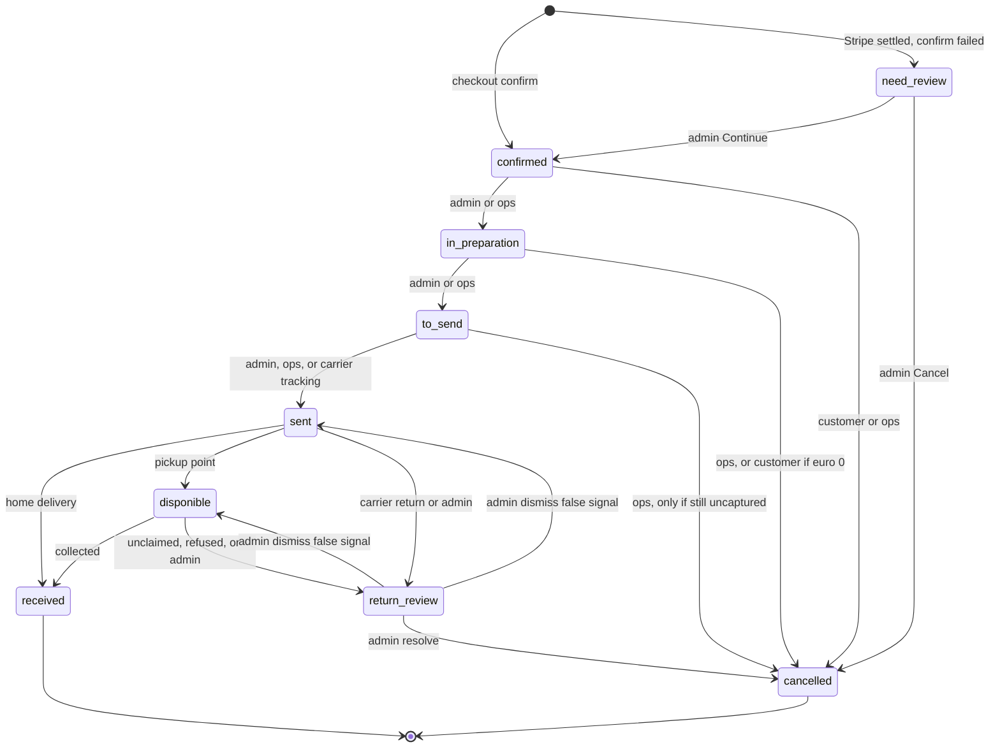
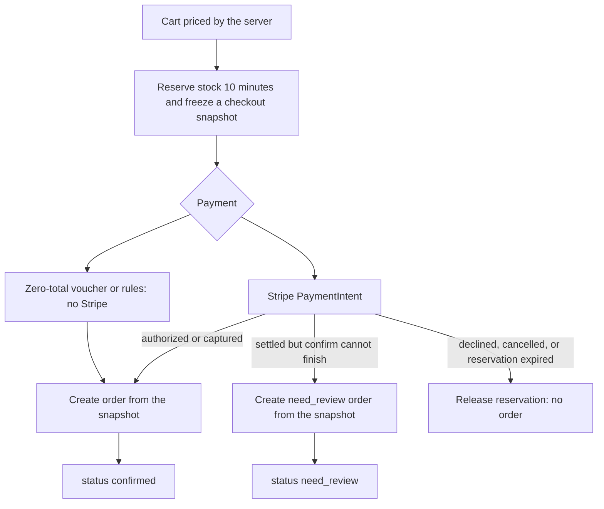
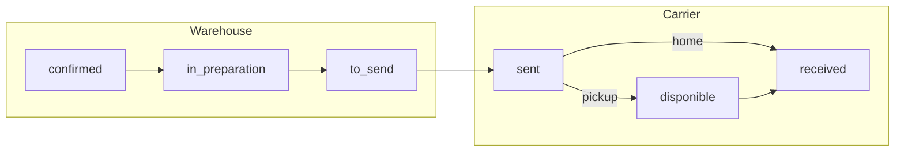
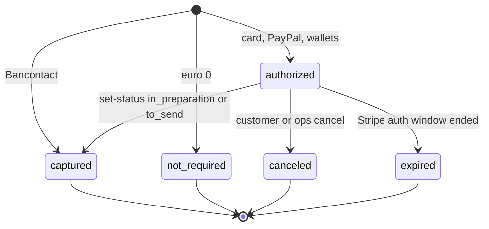

# Order lifecycle

How a Lumen order is created, how it moves, and what every status means.

This page is the map. Endpoint contracts live in [API](./api/README.md),
columns in [schema](./schema/03-pricing-cart-orders.md), fulfillment CLI in
[`npm run order`](./command/03-ops.md#npm-run-order), and carrier polling in
[cron](./cron/README.md).

An order exists only after checkout settles. There is no draft-order status.
Cart lines, prices, courier, addresses, voucher, and loyalty amounts are
frozen into snapshots at confirm. Later catalogue or address edits never
rewrite a placed order. The customer-facing number is `CMD-000001` (Postgres
sequence), not the UUID primary key.

Two independent fields describe the same row:

| Field | What it answers |
| --- | --- |
| `orders.status` | Where the parcel is in fulfillment (or which exception it is in) |
| `orders.payment_capture_status` | Whether money is held, taken, unused, released, or expired |

Changing one never automatically invents a value for the other. Capture can
expire while the order stays `confirmed`. A return can cancel a `sent` order
whose payment was already `captured`.

---

## All lifecycle statuses

Stored on `orders.status`. The check constraint is the full list; nothing
else is legal.

| Status | Kind | Meaning | Customer UI |
| --- | --- | --- | --- |
| `confirmed` | Happy path | Payment settled (or €0 confirmed). Waiting for preparation. | Badge |
| `in_preparation` | Happy path | Warehouse is assembling the parcel. | Badge |
| `to_send` | Happy path | Packed, label typically generated, not yet handed to the carrier. | Badge |
| `sent` | Happy path | Physically handed over. `sent_at` is stamped here and kept. | Badge |
| `disponible` | Happy path | Pickup-point / locker only: parcel is waiting for collection. | Badge |
| `received` | Terminal | Delivered or collected. History list. | Badge |
| `cancelled` | Terminal | Not fulfilled. History list. | Badge |
| `need_review` | Exception | Stripe settled, but the ordinary confirm transaction could not finish. | Visible in the active list, **no badge** |
| `return_review` | Exception | A shipped parcel looks unclaimed, refused, or returning. Waiting for an administrator. | Badge |

`disponible` is Point Relais / locker only. Home delivery never uses it:
`sent` goes straight to `received`.

`need_review` and `return_review` are not fulfillment steps. Operations
(`npm run order`, `/operation/orders`) cannot create or resolve them. They
are browser-admin only.

---

## Full status graph



Forward fulfillment is one step at a time. There is no skip and no
backwards move, except:

- admin Continue from `need_review` lands on `confirmed` (it never jumps
  into preparation);
- admin dismiss of `return_review` restores the previous `sent` or
  `disponible`;
- admin “mark received” from `sent` on a pickup-point order walks
  `sent → disponible → received` in one request.

Re-sending an order’s **current** status through ops is a no-op. The
browser-admin `to_send` action refuses a second `to_send` and expects
`sent` next.

---

## Checkout: how an order is born



Checkout never rereads the mutable cart at confirm. The order is written
from `checkout_reservation_snapshots`. Account and guest share that rule;
guest confirm never auto-attaches to an existing account with the same
email.

### Payment methods at confirm

| Method | Stripe capture | Initial `payment_capture_status` |
| --- | --- | --- |
| Card, PayPal, Google Pay, Apple Pay | `manual` — authorize only | `authorized` |
| Bancontact | `automatic` — Stripe settles at confirm | `captured` |
| Voucher / rules covering the whole total | No PaymentIntent (`free:<reservationId>`) | `not_required` |

Wallet payments are stored as `payment_method_type = card` once Stripe
returns the underlying card.

A confirmation email is sent when the order row is created, including
`need_review`. The customer can see that order in the active list; the
shop UI hides the status badge until an administrator Continues it into
`confirmed`.

---

## Happy-path fulfillment

Home delivery:

```text
confirmed → in_preparation → to_send → sent → received
```

Pickup point (order has `pickup_point`):

```text
confirmed → in_preparation → to_send → sent → disponible → received
```



Who typically moves each step:

| Transition | Usual actor |
| --- | --- |
| `confirmed → in_preparation` | Admin dashboard or `npm run order -- set-status` |
| `in_preparation → to_send` | Same, generates the Mondial Relay PDF unless skipped / unsupported |
| `to_send → sent` | Admin, ops, or Mondial Relay tracking (`PRISE EN CHARGE POINT RELAIS`) |
| `sent → disponible` | Tracking (available at point / locker) or admin “mark received” walk |
| `sent → received` or `disponible → received` | Tracking (`Livré`, collected) or admin |

Chronopost home and Colissimo home have no automated label adapter: moving
to `to_send` skips the carrier PDF automatically. Record the tracking
number later with `npm run order -- set-tracking`.

---

## Payment capture statuses

Orthogonal to `orders.status`. Stored on `orders.payment_capture_status`.

| Status | Meaning |
| --- | --- |
| `authorized` | Manual-capture hold. Funds are not taken yet. |
| `captured` | Funds taken (ops/admin capture, or Bancontact automatic settle). |
| `not_required` | €0 order. No Stripe money movement. |
| `canceled` | Authorization released on cancel-before-capture. |
| `expired` | Stripe auth window ended. Funds were never taken. Lifecycle status is unchanged. |



Default capture moment: entering `in_preparation` (unless admin/ops pass
`noPayment` / `--no-payment`). Entering `to_send` **always** captures if
the hold is still `authorized`. Capture failure leaves the lifecycle
status unchanged.

Bancontact is already `captured` at confirm, so those flags do nothing
financially.

**Captured funds are never refunded automatically.** Cron, webhooks, and
ops `set-status … cancelled` must not invent a refund. The only documented
human refund paths are:

- `need_review` → admin Cancel (authorization cancel, or full refund if
  already captured);
- `return_review` → admin Resolve (full / courier-deduction / custom /
  none).

After a card/PayPal hold has been captured, ordinary ops cancel is
refused. There is no captured-but-unshipped refund button on the admin
order screen.

---

## Per-status notes

### `confirmed`

The order exists. Stock reservation is `consumed` (counts against
availability, source quantity is not yet decremented). Loyalty spend is
already applied; earn is `pending`.

The owning customer may:

- amend delivery (same courier, same country, no fee change) and billing
  under a revision lock (`ORDER_REVISION_LOCK_TTL`, default 30 minutes).
  The lock blocks ops `set-status` until save/close, or
  `--bypass-lock-edit`;
- self-cancel with `DELETE /account/orders/:id` while payment is still
  `authorized`, or while the order is €0 / `not_required`.

Guests cannot use that cancel route until the order is claimed onto an
account.

### `in_preparation`

Same customer address-edit rules as `confirmed`. Customer self-cancel
remains only for €0 / `not_required` orders. Authorized card/PayPal
orders can no longer be cancelled by the customer once preparation
started (the hold is usually already captured).

Optional customer email if the admin ticks notify on this transition.

### `to_send`

Packed. For Mondial Relay, the server generates and stores the A4 PDF
label unless `skipShippingLabel` / `--skip-shipment-label` is set.
Customer address edits are closed. Ops cancel is still allowed **only
while payment is not `captured`**.

Optional customer email if the admin ticks notify.

`set-tracking` becomes legal from here onward (`to_send`, `sent`,
`disponible`, `received`). It never changes status by itself.

### `sent`

Physical handoff. On this transition the server:

1. copies reserved units into `order_fulfillment_stock`;
2. decrements `product_availability`;
3. deletes the consumed reservation;
4. stamps `sent_at`;
5. sends the shipped email.

Cancellation by ops or customer is closed. The remaining exits are
carrier/admin `received` / `disponible`, or `return_review`.

### `disponible`

Pickup-point waiting. Customer tracking and the hourly shipment cron
both apply cached Mondial Relay events; a high-confidence “available”
label moves the order here. Days spent at the point are derived from
`status_updated_at`.

### `received`

Delivered or collected. Account customers get a “received” email. Guests
get the idempotent invoice PDF attached (they have no account invoice
route). Account invoices are generated on demand from
`GET /account/orders/:id/invoice` as soon as the order is not
`need_review` — they are not tied to this status.

The order sits in history. An administrator must still
`POST /admin/orders/:id/verify`. Verify is what grants loyalty earn to a
linked account. Verify of an unclaimed guest order waits until claim,
then grants.

### `cancelled`

Not fulfilled. Stock reservation is deleted (units available again).
Pending earn is voided; loyalty spent as payment is restored
(`spend_refund`). An uncaptured authorization is canceled. A captured
PaymentIntent is **not** refunded on this path.

Sources:

- customer self-cancel (narrow rules above);
- ops `set-status … cancelled` from `confirmed` / `in_preparation` /
  `to_send` while uncaptured;
- admin Cancel of `need_review`;
- admin Resolve of `return_review`.

Verify still applies on the admin hub (`admin_verified_at`).

### `need_review`

Checkout/payment exception, not a warehouse state. Created when Stripe
has authorized or captured but writing the normal `confirmed` order
failed. `status_reason` is admin-only.

- **Continue** — verify Stripe, do not capture, then `confirmed`.
  Disabled when `need_review_blocked` (unsafe ownership / amount /
  stock).
- **Cancel** — explicit financial action: cancel the authorization or
  refund captured funds, then `cancelled`.

No cron, worker, or `npm run order` command performs that choice.

### `return_review`

Opened from `sent` or `disponible` when tracking reports unclaimed,
refused, or return-to-sender — or when an administrator advances to
return review by hand. Detection records evidence only. It never
refunds, restocks, or sends the outcome email.

- **Resolve** — administrator chooses refund mode, courier retention,
  restock quantities. Success moves the order to `cancelled` and
  auto-verifies it.
- **Dismiss** — false signal; restore previous `sent` / `disponible`.
  That exact carrier evidence is suppressed so the next cron pass does
  not reopen the same case. Later distinct evidence can open a new one.

If the order is still `to_send` when a return signal arrives, tracking
first moves it to `sent` (so the stock ledger exists) without sending a
late shipped email, then opens review.

---

## Who is allowed to change status

| Actor | What it can do |
| --- | --- |
| Checkout / Stripe webhook | Insert `confirmed` or `need_review` only |
| Customer | Self-cancel to `cancelled` under the narrow payment rules. Tracking view may walk `to_send`/`sent`/`disponible` forward when Mondial Relay already reports the milestone. Cannot set other statuses. |
| Admin dashboard | One-step warehouse moves, mark received, open/resolve/dismiss return review, Continue/Cancel `need_review`, verify terminals. No ordinary pre-shipment Cancel button. |
| `npm run order -- set-status` | Same warehouse path as admin, plus `cancelled` from `confirmed`/`in_preparation`/`to_send` if still uncaptured. Cannot touch `need_review` or `return_review`. |
| Shipment cron | Mondial Relay orders in `to_send`/`sent`/`disponible` with a shipment number. Forward milestones and return detection only. Never refunds. |

Admin hub badges count `confirmed`, `disponible`, `need_review`,
`return_review`, plus unverified `received` and `cancelled`.

---

## Side effects by transition

| Event | Stock | Money | Email | Other |
| --- | --- | --- | --- | --- |
| Confirm | Reservation `consumed` | Hold or Bancontact capture or none | Confirmation | Cart lines removed |
| `→ in_preparation` | — | Capture unless `noPayment` | Optional notify | — |
| `→ to_send` | — | Capture if still authorized | Optional notify | Mondial Relay PDF (unless skipped) |
| `→ sent` | Decrement source qty, drop reservation, copy fulfillment ledger | — | Shipped | Stamp `sent_at` |
| `→ disponible` | — | — | — | — |
| `→ received` | — | — | Received (account) or invoice PDF (guest) | Card-retention bump |
| Customer / ops cancel | Release consumed reservation | Release authorization only | Cancellation (customer path) | Void pending earn; restore loyalty spend |
| `need_review` Continue | Keep / consume holds | Verify only | (already sent at insert) | Becomes `confirmed` |
| `need_review` Cancel | Release | Cancel auth or refund captured | — | Becomes `cancelled` |
| Return resolve | Restock chosen units | Refund as chosen | Final return email | Earn reversal / retain spent earn on cash |
| Return dismiss | — | — | — | Restore previous status |
| Admin verify `received` | — | — | — | Grant loyalty earn when `user_id` is set |

No path auto-refunds a captured PaymentIntent. Invoice PDF numbers are
idempotent (`FACT-…`); generating twice does not issue a second document.

---

## Customer lists

| Shop list | Statuses |
| --- | --- |
| Active | `confirmed`, `in_preparation`, `to_send`, `sent`, `disponible`, `need_review`, `return_review` |
| History | `received`, `cancelled` |

Tracking is offered when the live courier catalog says the courier
supports it, from `to_send` onward, and a shipment number exists. Opening
tracking uses the same milestone walk as the cron.

---

## Local fulfillment archive

`npm run order -- seed` copies ordinary fulfillment orders into
`../pamsurin-manager/order/<status>/<orderNumber>.json` (DB → local only).
`need_review` and `return_review` are excluded. Each order lives in one
status folder; a later `set-status` moves that file.

---

## Pointers

| Topic | Where |
| --- | --- |
| `orders` columns, reservations, revisions, labels, invoices | [schema/03-pricing-cart-orders.md](./schema/03-pricing-cart-orders.md) |
| Loyalty earn / spend / return retention | [schema/07-loyalty.md](./schema/07-loyalty.md) |
| Admin list, verify, need-review, return-review, `PATCH` status | [api/01-admin.md](./api/01-admin.md) |
| Customer orders, invoice, tracking, checkout | [api/03-account.md](./api/03-account.md), [api/04-guest-checkout.md](./api/04-guest-checkout.md) |
| Ops list / set-status / tracking / delete | [api/07-operation.md](./api/07-operation.md), [command/03-ops.md](./command/03-ops.md) |
| Hourly Mondial Relay walk | [cron/README.md](./cron/README.md) |
