# User accounts

Added by `1738000004000_users_auth_core.js`,
`1738000005000_addresses_and_countries.js` and `1738000006000_favorites.js`.
Same app-generated-`uuid` convention as `products.id`/`product_photos.id`
above — no DB default, same Postgres-10/no-pgcrypto reason.

```mermaid
erDiagram
    users {
        uuid id PK
        text email
        text email_lookup UK
        text password_hash
        text first_name
        text last_name
        text phone
        timestamptz email_verified_at
        text pending_email
        text pending_email_lookup UK
        text status
        text role FK
        timestamptz locked_at
        timestamptz deletion_scheduled_for
        integer failed_login_attempts
        timestamptz lockout_until
        timestamptz last_connected_at
        integer connection_count
        text stripe_customer_id UK
        text gdpr_consent_version
        timestamptz gdpr_consent_at
        timestamptz created_at
        timestamptz updated_at
    }
    roles {
        text code PK
        text label
        boolean system
        timestamptz created_at
        timestamptz updated_at
    }
    permissions {
        text code PK
        text label
        integer sort_order
    }
    role_permissions {
        text role_code PK,FK
        text permission_code PK,FK
        boolean granted
        boolean dominant
        timestamptz granted_at
    }
    role_parents {
        text role_code PK,FK
        text parent_code PK,FK
        timestamptz created_at
    }
    user_roles {
        uuid user_id PK,FK
        text role_code PK,FK
        timestamptz assigned_at
    }
    refresh_tokens {
        uuid id PK
        uuid user_id FK
        text token_hash UK
        uuid family_id
        uuid replaced_by FK
        boolean remember_me
        text created_by_ip
        text user_agent
        text login_location
        timestamptz expires_at
        timestamptz revoked_at
    }
    password_reset_tokens {
        uuid id PK
        uuid user_id FK
        text token_hash UK
        timestamptz expires_at
        timestamptz used_at
    }
    password_reset_sends {
        uuid id PK
        uuid user_id FK
        timestamptz sent_at
    }
    email_confirmation_tokens {
        uuid id PK
        uuid user_id FK
        text email
        text email_lookup
        text token_hash UK
        text otp_hash
        timestamptz expires_at
        timestamptz used_at
    }
    email_confirmation_sends {
        uuid id PK
        uuid user_id FK
        text email
        timestamptz sent_at
    }
    email_change_sends {
        uuid id PK
        uuid user_id FK
        timestamptz sent_at
    }
    account_lock_tokens {
        uuid id PK
        uuid user_id FK
        text token_hash UK
        timestamptz expires_at
        timestamptz used_at
        timestamptz created_at
    }
    account_unlock_tokens {
        uuid id PK
        uuid user_id FK
        text action
        text token_hash UK
        timestamptz expires_at
        timestamptz used_at
        timestamptz created_at
    }
    auth_otp_tokens {
        uuid id PK
        text email_lookup
        uuid user_id FK
        text purpose
        text otp_hash
        text gdpr_consent_version
        text language
        text unlock_action
        timestamptz expires_at
        timestamptz used_at
        integer failed_attempts
        timestamptz created_at
    }
    auth_otp_sends {
        uuid id PK
        text email_lookup
        uuid user_id FK
        text purpose
        timestamptz sent_at
    }
    user_preference {
        uuid user_id PK, FK
        text key PK
        text value
        timestamptz created_at
        timestamptz updated_at
    }
    address_countries {
        text code PK
        jsonb label
        boolean enabled
        integer sort_order
    }
    addresses {
        uuid id PK
        uuid user_id FK
        text kind
        text label
        text recipient_name
        text company_name
        text line1
        text line2
        text postal_code
        text city
        text country_code FK
        uuid checkout_privacy_session_id FK
        text phone
        boolean is_default
        timestamptz created_at
        timestamptz updated_at
    }
    checkout_privacy_sessions {
        uuid id PK
        text token_hash UK
        uuid user_id FK
        text key_ciphertext
        timestamptz last_activity_at
        timestamptz expires_at
        timestamptz expired_at
    }
    checkout_privacy_session_payment_methods {
        uuid session_id PK, FK
        text stripe_payment_method_id PK
    }
    favorites {
        uuid user_id PK, FK
        uuid product_id PK, FK
        text shape_key
        text length_key
        timestamptz created_at
    }
    user_identity_events {
        uuid id PK
        uuid user_id FK
        text kind
        text email
        text email_lookup
        text previous_email
        text previous_email_lookup
        text provider_subject
        boolean backfilled
        timestamptz created_at
    }

    roles ||--o{ users : "assigned to"
    roles ||--o{ role_permissions : "grants"
    permissions ||--o{ role_permissions : "granted as"
    roles ||--o{ role_parents : "inherits"
    users ||--o{ user_roles : "holds"
    roles ||--o{ user_roles : "held by"
    users ||--o{ refresh_tokens : "has"
    users ||--o{ password_reset_tokens : "has"
    users ||--o{ password_reset_sends : "has"
    users ||--o{ email_confirmation_tokens : "has"
    users ||--o{ email_confirmation_sends : "has"
    users ||--o{ email_change_sends : "has"
    users ||--o{ account_lock_tokens : "has"
    users ||--o{ account_unlock_tokens : "has"
    users ||--o{ auth_otp_tokens : "has"
    users ||--o{ auth_otp_sends : "has"
    users ||--o{ user_preference : "has"
    users ||--o{ addresses : "has"
    users ||--o{ checkout_privacy_sessions : "may own"
    checkout_privacy_sessions ||--o{ addresses : "scopes one-time"
    checkout_privacy_sessions ||--o{ checkout_privacy_session_payment_methods : "allows guest token"
    address_countries ||--o{ addresses : "used by"
    users ||--o{ favorites : "has"
    users ||--o{ user_identity_events : "has"
    product_shapes ||--o{ favorites : "used by"
```

### `user_identity_events`

Append-only history of
committed identity changes on an account. `users` remains the live
projection; this table is for admin consultation and email search across
former addresses. Rows cascade-delete with the account (GDPR hard-delete).

| Column                                     | Type                                               | Notes                                                                                                                                                |
| ------------------------------------------ | -------------------------------------------------- | ---------------------------------------------------------------------------------------------------------------------------------------------------- |
| `id`                                       | `uuid` PK                                          | App-generated.                                                                                                                                       |
| `user_id`                                  | `uuid not null` FK → `users(id) on delete cascade` |                                                                                                                                                      |
| `kind`                                     | `text not null`                                    | `account_created`, `email_changed`, `google_linked` / `google_unlinked`, `facebook_linked` / `facebook_unlinked`, `apple_linked` / `apple_unlinked`. |
| `email` / `email_lookup`                   | `text` null / `text` null                          | Ciphertext + HMAC of the email involved (new main, or provider profile email). Not unique — a former address may later belong to another account.    |
| `previous_email` / `previous_email_lookup` | `text` null / `text` null                          | Set only for `email_changed` (old main).                                                                                                             |
| `provider_subject`                         | `text` null                                        | `google_sub` / `facebook_user_id` / `apple_sub` when the event is a social link/unlink.                                                              |
| `backfilled`                               | `boolean not null default false`                   | `true` for seed rows from `POST /operation/database-migrate` (pre-migration email changes are not reconstructible).                                  |
| `created_at`                               | `timestamptz not null default now()`               | Change instant; seed `account_created` uses `users.created_at`.                                                                                      |

Indexes: `user_identity_events_user_idx (user_id, created_at desc)`, partial
`user_identity_events_email_lookup_idx` / `user_identity_events_previous_email_lookup_idx`.
Pending email requests, password changes, locks, and login sessions are
**not** recorded here. Register/login uniqueness stays on live `users`
columns only.

### `users`

| Column                                                                           | Type                                                                                          | Notes                                                                                                                                                                                                                                                                                                                                                                                                                                                                                                                                                                                                                                                  |
| -------------------------------------------------------------------------------- | --------------------------------------------------------------------------------------------- | ------------------------------------------------------------------------------------------------------------------------------------------------------------------------------------------------------------------------------------------------------------------------------------------------------------------------------------------------------------------------------------------------------------------------------------------------------------------------------------------------------------------------------------------------------------------------------------------------------------------------------------------------------ |
| `id`                                                                             | `uuid` PK                                                                                     | App-generated. Deliberately not `email` — email is changeable (see `pending_email` below), so nothing else references it as an identifier.                                                                                                                                                                                                                                                                                                                                                                                                                                                                                                             |
| `email`                                                                          | `text not null`                                                                               | **AES-GCM ciphertext** (`v1:…`). Not unique — uniqueness is on `email_lookup`.                                                                                                                                                                                                                                                                                                                                                                                                                                                                                                                                                                         |
| `email_lookup`                                                                   | `text not null unique`                                                                        | HMAC-SHA256 blind index of `lower(trim(email))` via `PII_LOOKUP_PEPPER`. Login / register / reset / ops exact search use this (`findUserByEmailLower`).                                                                                                                                                                                                                                                                                                                                                                                                                                                                                                |
| `password_hash`                                                                  | `text`, nullable                                                                              | Argon2id, pinned to `argon2@0.41.1` (see `modules/identity/application/password.ts`) — newer argon2 releases ship prebuilt binaries requiring glibc 2.34, which the LWS host does not have; verify on the real host before bumping. Peppered with a server-side HMAC before hashing. Legacy `scryptp1$…` / unpeppered `scrypt$…` hashes from before the argon2 migration remain verifiable; a successful password login rewrites them to argon2id. A change/reset also writes argon2id. Null for accounts created via in-cart OTP signup (`POST /auth/verify-otp` purpose `signup`) or social sign-in until the customer sets one.                                                                                                                                                                                                                                                                               |
| `cancelled_password_hash` / `password_cancelled_at` / `password_cancelled_reason` | `text`, nullable / `timestamptz`, nullable / `text`, nullable, CHECK `social_link` or `email_verification` | Added by `1791200000000_password_cancelled.js`. Account pre-hijacking guard (`cancelPasswordOnInboxProof` in `modules/identity/application/users.ts`): the first social sign-in link from the sign-in screen, or an OTP / manage-guest-order sign-in on a never-verified email, moves `password_hash` here and revokes every refresh token. The kept hash never authenticates; it only lets a login that types it get `password_cancelled`. Setting a new password (`updatePasswordHash`) clears all three. |
| `google_sub`                                                                     | `text`, nullable, unique                                                                      | Added by `1787390000000_google_sign_in.js`. Stable Google user id (`sub` from a verified GIS ID token). Lookup precedes email on Google login; backfilled when an existing email account first connects Google.                                                                                                                                                                                                                                                                                                                                                                                                                                        |
| `google_email` / `google_email_lookup`                                           | `text`, nullable / `text`, nullable, unique (partial)                                         | Added by `1787410000000_google_email_and_link_tokens.js`. Verified Google profile email (ciphertext + HMAC) when Sign in with Google is linked. May equal main `email` (Google signup / switch) or differ (keep-main link). Informational when ≠ main — login/OTP/mail use `email` only. Cleared with `google_sub` on unlink.                                                                                                                                                                                                                                                                                                                          |
| `facebook_user_id`                                                               | `text`, nullable, unique (partial)                                                            | Added by `1787420000000_facebook_sign_in.js`. Stable Facebook user id from Graph `/me`. Lookup precedes email on Facebook login; backfilled when an existing email account first connects Facebook.                                                                                                                                                                                                                                                                                                                                                                                                                                                    |
| `facebook_email` / `facebook_email_lookup`                                       | `text`, nullable / `text`, nullable, unique (partial)                                         | Added by `1787420000000_facebook_sign_in.js`. Verified Facebook profile email (ciphertext + HMAC). Same keep/switch semantics as Google. Cleared with `facebook_user_id` on unlink.                                                                                                                                                                                                                                                                                                                                                                                                                                                                    |
| `apple_sub`                                                                      | `text`, nullable, unique (partial)                                                            | Stable Apple user id (`sub` from a verified identity token). Lookup precedes email on Apple login; backfilled when an existing email account first connects Apple.                                                                                                                                                                                                                                                                                                                                                                                                                                          |
| `apple_email` / `apple_email_lookup`                                             | `text`, nullable / `text`, nullable, unique (partial)                                         | Apple profile email when provided (ciphertext + HMAC). Same keep/switch semantics as Google; may be absent on later Sign in with Apple. Cleared with `apple_sub` on unlink.                                                                                                                                                                                                                                                                                                                                                                                                                                 |
| `first_name` / `last_name` / `phone`                                             | `text`, nullable                                                                              | **Ciphertext**. Filled via `PATCH /account/profile` — registration is email+password or email+OTP only.                                                                                                                                                                                                                                                                                                                                                                                                                                                                                                                                                |
| `email_verified_at`                                                              | `timestamptz`, nullable                                                                       | Set once the registration confirmation link is used, or immediately on OTP signup (inbox proof). Account is fully usable before this for password register — verification is informational, not a gate.                                                                                                                                                                                                                                                                                                                                                                                                                                                |
| `pending_email`                                                                  | `text`, nullable                                                                              | **Ciphertext**. Set by `POST /account/change-email`; becomes `email` only once its own confirmation token is used.                                                                                                                                                                                                                                                                                                                                                                                                                                                                                                                                     |
| `pending_email_lookup`                                                           | `text`, nullable, unique                                                                      | HMAC of pending email; conflict checks share `findUserByEmailLower` (matches live or pending).                                                                                                                                                                                                                                                                                                                                                                                                                                                                                                                                                         |
| `status`                                                                         | `text not null default 'active'`, `check in ('active','pending_deletion','deleted','locked')` | `'deleted'` is never actually observed on a row still in the table — `processPermanentDeletions` hard-deletes the row outright, one transaction per account. Deletion no longer takes the customer's orders with it: `1787380000000_order_customer_snapshot_and_orphan.js` detaches them first (see `orders.owner_deleted_at` in [pricing/cart/orders](03-pricing-cart-orders.md)), so the row can go while the invoice history stays. `'locked'` added by `1738000024000_account_security_lock.js` — see `locked_at` and `accountSecurityLock.service.ts` below; distinct from the temporary `lockout_until` mechanism, which never touches `status`. |
| `role`                                                                           | `text not null default 'user'`, FK to `roles(code)`                                           | Summary of the account's `user_roles`: `super-admin` when held, else the first staff role, else `user` (customer). Any value other than `user` opens the Administration menu, limited to the permissions resolved from every held role.                                                                                                                                                                                                                                                                                                                                                                                                                                                                                  |
| `deletion_requested_at` / `deletion_scheduled_for` / `deletion_reminder_sent_at` | `timestamptz`, nullable                                                                       | Set together by `requestDeletion` (`POST /account/request-deletion`); all three cleared by `reactivateIfPendingDeletion`, which fires either on a login during the grace window or an explicit `POST /account/cancel-deletion`.                                                                                                                                                                                                                                                                                                                                                                                                                        |
| `failed_login_attempts` / `lockout_until`                                        | `integer` / `timestamptz`                                                                     | Per-account, temporary, auto-expiring throttle (`modules/auth/application/loginAttempts.ts`) — further invalid credentials return `423`, while a valid password/OTP/social proof still succeeds and clears the window so the mechanism cannot be weaponized to deny service to the owner. Independent of the per-IP `loginRateLimiter` and of `status = 'locked'` below.                                                                                                                                                                                                                                                                                       |
| `locked_at`                                                                      | `timestamptz`, nullable                                                                       | Added by `1738000024000_account_security_lock.js`. Set when `status` flips to `'locked'` — either via `account_lock_tokens` (customer's own "this wasn't me" link, sent to the old address on an email-change request) or `POST /operation/accounts/:idOrEmail/lock` (operator-initiated). No self-service unlock; only `POST /operation/accounts/:idOrEmail/unlock` reverses it. Both paths also revoke every `refresh_tokens` row for the account.                                                                                                                                                                                                   |
| `lock_reason`                                                                    | `text`, nullable                                                                              | Human-readable reason stored when the account is locked. Cleared on unlock. Customer self-service locks use a fixed French system message; admin locks require a reason in the request body; ops/CLI locks accept an optional reason (default operator message when omitted).                                                                                                                                                                                                                                                                                                                                                                            |
| `lock_source`                                                                    | `text`, nullable, check in (`customer`,`admin`,`ops`)                                         | Who initiated the durable lock: `customer` (email-change alert link), `admin` (`POST /admin/users/:id/lock`), or `ops` (`POST /operation/accounts/:idOrEmail/lock` / `npm run user -- lock`). Cleared on unlock.                                                                                                                                                                                                                                                                                                                                                                                                                                      |
| `locked_by_user_id`                                                              | `uuid` FK → `users(id)` on delete set null, nullable                                          | Administrator who locked the account through the browser UI when `lock_source = 'admin'`. Null for customer or ops locks.                                                                                                                                                                                                                                                                                                                                                                                                                                                                                                                              |
| `last_connected_at` / `connection_count`                                         | `timestamptz`, nullable / `integer not null default 0`                                        | Added by `1738000025000_users_connection_tracking.js`. Bumped by `recordConnection` (`users.service.ts`) on **both** a manual `/auth/login` and a silent `/auth/refresh` — "connected" covers either kind of session activity. Backs `GET /operation/users`' `--sort last-connected/most-connected/least-connected`.                                                                                                                                                                                                                                                                                                                                   |
| `gdpr_consent_version` / `gdpr_consent_at`                                       | `text not null` / `timestamptz not null`                                                      | Captured once at registration (server-stamped version, not client-supplied — see `src/config/gdpr.ts`'s `GDPR_CONSENT_VERSION`). No re-consent history yet; would need a separate table if a second consent purpose (e.g. marketing) is ever added.                                                                                                                                                                                                                                                                                                                                                                                                    |
| `stripe_customer_id`                                                             | `text`, nullable, unique                                                                      | Added by `1738000010000_stripe_payments.js`. Created lazily on a user's first checkout or first "add card" action (`stripe.service.ts`'s `getOrCreateCustomer`), not at registration — most users never reach checkout, and there's no reason to clutter the Stripe dashboard with a Customer object for every signup. Unique constraint allows any number of `NULL`s.                                                                                                                                                                                                                                                                                 |
| `created_at` / `updated_at`                                                      | `timestamptz not null default now()`                                                          | Standard pair, present on nearly every table in this schema.                                                                                                                                                                                                                                                                                                                                                                                                                                                                                                                                                                                           |

Indexes: `users_email_lookup_key` (unique), `users_pending_email_lookup_key` (unique), partial unique `users_google_sub_key (google_sub) where google_sub is not null`, partial unique `users_google_email_lookup_key (google_email_lookup) where google_email_lookup is not null`, partial unique `users_facebook_user_id_key` / `users_facebook_email_lookup_key`, partial unique `users_apple_sub_key` / `users_apple_email_lookup_key`, `users_status_idx (status)`, `users_last_connected_idx (last_connected_at)`, partial `users_deletion_scheduled_idx (deletion_scheduled_for) where status = 'pending_deletion'` (what `processReminders`/`processPermanentDeletions` scan).

Retention of the one-shot token tables: `pruneExpiredAuthArtifacts`
(`authArtifactMaintenance.ts`, at most once per process every six hours)
deletes rows of `google_signup_tokens`, `facebook_signup_tokens`,
`apple_signup_tokens`, `social_auth_pending`, `google_link_tokens`,
`facebook_link_tokens`, `apple_link_tokens`, `account_lock_tokens` and
`account_unlock_tokens` seven days after `expires_at` or `used_at`, and
`email_change_sends` after 35 days, beside the auth tables it already pruned.

### `google_signup_tokens`

Added by `1787390000000_google_sign_in.js`. Short-lived pending signup after a verified Google ID token when CGU consent is still required — no `users` row until `POST /auth/google/complete`. Same hashed-token shape as password-reset tokens (`token_hash unique`, `expires_at`, `used_at`). Stores encrypted `email`, `email_lookup`, `google_sub`, and signup `language`.

### `google_link_tokens`

Added by `1787410000000_google_email_and_link_tokens.js`. Short-lived pending Account link when GIS email ≠ current `users.email` — customer must choose keep vs switch via `POST /account/link-google/complete`. Stores `user_id`, `google_sub`, encrypted `google_email` + lookup. TTL shares `GOOGLE_SIGNUP_TOKEN_TTL`.

### `facebook_signup_tokens` / `facebook_link_tokens`

Added by `1787420000000_facebook_sign_in.js`. Same shapes as the Google tables for Facebook Login (`facebook_user_id`, encrypted email). TTL shares `FACEBOOK_SIGNUP_TOKEN_TTL` (default 10m).

### `apple_signup_tokens` / `apple_link_tokens`

Same shapes as the Google tables for Sign in with Apple (`apple_sub`, encrypted email). TTL shares `APPLE_SIGNUP_TOKEN_TTL` (default 10m). Signup requires an email claim; later Apple authorizations may omit email on login-by-sub.

### `apple_s2s_notifications`

Idempotency/audit log for Sign in with Apple server-to-server notifications (`POST /auth/apple/notifications`). Columns: `jti` (unique), `event_type`, `apple_sub`, optional `user_id` (set when an unlink finds a matching account), `created_at`.

### `social_auth_pending`

Holds a verified Google/Apple/Facebook identity when the matching shop preference `sign_in_*_verbose_enabled` is on and the social email does not match an existing Lumen user — until the shopper chooses create (`POST /auth/social/create`) or link-via-OTP (`POST /auth/social/link/*`). Columns: `provider`, `provider_subject`, optional encrypted `email` / `email_lookup`, `language`, hashed token, `expires_at`, `used_at`. TTL shares `GOOGLE_SIGNUP_TOKEN_TTL`. `auth_otp_tokens` / `auth_otp_sends` purpose CHECKs include `social_link`.

### `facebook_data_deletion_requests`

Added by `1787430000000_facebook_data_deletion.js`. Audit/status rows for Meta's Data Deletion Request Callback (`POST /auth/facebook/data-deletion`). Stores `confirmation_code` (unique), `facebook_user_id`, optional `user_id`, `status` (`facebook_unlinked` | `account_deletion_scheduled` | `no_matching_account`), and optional `deletion_scheduled_for`.

Deleting a `users` row cascades to every child table listed in this document
except three, which deliberately outlive the account:

- `orders.user_id` — FK left as `NO ACTION` on purpose. An order may only be
  detached by `accountDeletion.service.ts`, which sets `owner_deleted_at` in
  the same statement; a bare `delete from users` still fails loudly rather than
  producing an order that violates `orders_owner_chk`. Ops immediate delete
  (`DELETE /operation/accounts/:idOrEmail`, `npm run user -- delete`) uses that
  same orphan path by default; pass `deleteOrders` / `--delete-orders` to wipe
  the orders instead.
- `voucher_redemptions.user_id` and `stock_reservations.user_id` — both
  `ON DELETE SET NULL` since `1787380000000`. A redemption is what stops a
  voucher being spent twice and a consumed reservation is what keeps sold stock
  out of the gallery until the order ships, so neither row may disappear with
  the account.

`loyalty_ledger.user_id` is `NOT NULL` with `ON DELETE SET NULL`, so hard-delete
(always, cron or ops) deletes those ledger rows for the user before removing
the `users` row.

PII at rest: `email`, `pending_email`, `first_name`, `last_name`, `phone`, address free-text fields, order address snapshots, confirmation-token emails, and `cardholder_name` are AES-256-GCM encrypted with `PII_ENCRYPTION_KEY` (see `piiCrypto.service.ts`). Generate keys with `npm run operation -- generate-key db`. Invoice/Mondial PDFs on disk remain plaintext files.

### `roles`

Natural-key lookup table (`code text primary key`, `label text not null`) —
same convention as `delivery_networks(code)`. `users.role` defaults to `user`.
`system = true` marks the two built-in roles, `user` (customer) and
`super-admin` ("Super-administrateur"; code `admin` before
`1791331200000_staff_roles.js`, see
[migration-history.md](./migration-history.md)),
which the administration Roles page can neither edit nor delete. Every other
row is a staff role created on that page (`1791331200000_staff_roles.js`
seeds `preparator`); its `code` is derived once from its first `label` and
never changes, `label` can be renamed. The foreign keys to `roles(code)`
from `users.role`, `user_roles` and `role_parents.parent_code` do not
cascade: deleting a staff role goes through the application, which first
removes it from every account (recomputing their `users.role` summary) and
from every inheriting role, in one transaction.

### `permissions`

Vocabulary of administration sections a staff role can be granted
(`code text primary key`, French `label`, `sort_order`). The codes mirror
`PERMISSIONS` in `src/modules/identity/domain/staffPermissions.ts` and the
`AdminPermissionCode` contract; adding one is a migration row plus code and
the front label in every locale. The section each code gates is listed in
[`docs/api/01-admin.md`](../api/01-admin.md#access-roles-and-permissions).

### `role_permissions`

Grant matrix: at most one row per (`role_code`, `permission_code`), both FKs
`on delete cascade`. `granted` (on/off) and `dominant` (default `false`); a
row that is off and not
dominant is never stored (it means the same as no row). `super-admin` is granted
everything in code and has no rows; `user` has none. Seeded: `preparator`
holds `orders` and the four stock sections; `manager` holds the four
Catalogue sections plus `catalogue_edit` (the shared product editor and the vocabulary page) and
inherits `preparator`. Resolution: over an account's
roles and all their ancestors, a dominant off wins, otherwise any on wins,
otherwise off (see [`docs/api/01-admin.md`](../api/01-admin.md#access-roles-and-permissions)).
Read on every gated `/admin` request, so a change applies immediately.

### `role_parents`

Inheritance: one row per (`role_code`, `parent_code`); a role inherits every
grant of its parents, transitively. `role_code` cascades on delete;
`parent_code` does not (deleting a parent removes these rows first, see
`roles`). `CHECK (role_code <> parent_code)`; longer loops are
refused by the application (`409 role_cycle`) under a table lock, so two
concurrent edits cannot close one together. `user` and `super-admin` are never
parents. Indexed on `parent_code`.

### `role_assignable_roles`

Delegated assignment (`1791331200000_staff_roles.js`): one row
per (`role_code`, `assignable_code`), both FKs `on delete cascade`, `CHECK`
that `assignable_code` is never `super-admin` or `user`. Lists the roles
that holders of `role_code` may give or take away, provided their resolved
targetable list (`role_targetable_roles`) is not empty either: the two
lists are the right itself, there is no separate permission. `roles.assignable_dominant` marks a
role's list as dominant. Over an account's roles and their ancestors the
lists merge as a union narrowed to every dominant list (see
[`docs/api/01-admin.md`](../api/01-admin.md#access-roles-and-permissions)).
Indexed on `assignable_code`.

### `role_targetable_roles`

Which accounts a delegated assignment may touch
(`1791331200000_staff_roles.js`): one row per (`role_code`,
`target_code`), both FKs `on delete cascade`, `CHECK` that `target_code` is
never `super-admin`; `user` stands for an account holding no staff role.
`roles.targetable_dominant` marks the list as dominant; lists merge like
`role_assignable_roles`. An account is editable by a delegate only when every
role it holds is in the delegate's resolved list. Indexed on `target_code`.

### `user_roles`

The staff roles an account holds: one row per (`user_id`, `role_code`);
`user_id` cascades with the account, `role_code` does not (deleting a role
removes these rows first, see `roles`). `CHECK (role_code <> 'user')`: no row
means a customer. Backfilled from `users.role` by
`1791331200000_staff_roles.js`. `users.role` stays as a compatible
summary of this set, rewritten with it: `super-admin` when held, else the first
staff role by creation order, else `user`. Every create/edit/delete of a
role and every assignment is journaled (`roles.*`, `accounts.set_roles`,
`account.set_role` from the CLI).

### `account_lock_tokens`

Same hashed-token shape as `email_confirmation_tokens` (`id`, `user_id` FK
`on delete cascade`, `token_hash unique`, `expires_at`, `used_at`,
`created_at`) — single-use, expires after `ACCOUNT_SECURITY_LOCK_TOKEN_TTL`
(common `.env/.public.env`: `48h`). Issued by
`issueAccountLockToken` whenever `POST /account/change-email` runs, sent only
to the account's _current_ (pre-change) address, and with every super-admin
sign-in alert (one token per alert; see
[Auth](../api/02-auth.md#super-admin-sign-in-alert)). A super-admin session
counts as an automatic sign-in when it is refreshed after being idle at least
`SUPER_ADMIN_SIGNIN_ALERT_IDLE` (common `.env/.public.env`: `1h`),
measured from the previous `refresh_tokens.created_at`.

### `account_unlock_tokens`

Added by `1738000018000_account_unlock_tokens.js`. Step-up re-authentication
for sensitive account-settings actions (`modules/account/application/accountUnlock.ts`)
— a password re-entry (`POST /account/unlock`) is exchanged for one of these
short-lived, single-use, **action-scoped** tokens, so change-email/
change-password/deletion no longer need to ask for the password again
inline in the same request. Same hashed-token shape as `account_lock_tokens`
(`id`, `user_id` FK `on delete cascade`, `token_hash unique`, `expires_at`,
`used_at`, `created_at`), plus:

| Column   | Type                                                                                                             | Notes                                                                                                                                                                                                                                                                                                                                                             |
| -------- | ---------------------------------------------------------------------------------------------------------------- | ----------------------------------------------------------------------------------------------------------------------------------------------------------------------------------------------------------------------------------------------------------------------------------------------------------------------------------------------------------------- |
| `action` | `text not null check (action in ('profile','email','password','deletion','google','facebook','apple','social'))` | Scopes the token to exactly one sensitive action — a token issued to unlock `'email'` can never be replayed against `'password'` or `'profile'`. `'deletion'` covers account deletion; `'google'` / `'facebook'` / `'apple'` cover Account social link/unlink; `'social'` covers all providers from one unlock. |

Index: `account_unlock_tokens_user_idx (user_id)`.

### `customer_card_retention`

Tracks Stripe cards per customer for one-time vs saved purpose and delayed
detach after order `received` / `cancelled`. See `cardRetention.service.ts`
and `ONE_TIME_CARD_RETENTION_DAYS`. Same PAN (Stripe fingerprint) may exist
as several rows — each PaymentMethod keeps its own id. Google Pay / Apple
Pay never create a retention row: confirm treats a missing row as an
allowed checkout-only wallet card (see `consumeOneTimeCardForOrder`).

| Column                                                           | Type                                                                   | Notes                                                                                                                                                                                        |
| ---------------------------------------------------------------- | ---------------------------------------------------------------------- | -------------------------------------------------------------------------------------------------------------------------------------------------------------------------------------------- |
| `id`                                                             | `uuid` PK                                                              | Application-generated.                                                                                                                                                                       |
| `user_id`                                                        | `uuid` FK → `users.id` on delete cascade                               |                                                                                                                                                                                              |
| `stripe_payment_method_id`                                       | `text` unique                                                          | Current attached `pm_…`.                                                                                                                                                                     |
| `card_fingerprint`                                               | `text`                                                                 | Stripe `card.fingerprint` (not unique).                                                                                                                                                      |
| `brand` / `last4` / `exp_month` / `exp_year` / `cardholder_name` | display fields                                                         | No PAN stored.                                                                                                                                                                               |
| `purpose`                                                        | `text` check `one_time` \| `saved`                                     |                                                                                                                                                                                              |
| `checkout_use_status`                                            | `text` check `saved` \| `one_time_available` \| `one_time_consumed`    | Server-owned reuse lifecycle, deliberately separate from retention: a consumed one-time card remains available to the completed payment/refund trail but is never checkout-selectable again. |
| `one_time_consumed_order_id` / `one_time_consumed_at`            | `uuid` FK → `orders.id` / `timestamptz` nullable                       | Set atomically in the same transaction that creates the first order using a one-time card.                                                                                                   |
| `delete_after`                                                   | `timestamptz` nullable                                                 | Null when `saved`; set for `one_time`.                                                                                                                                                       |
| `last_order_id`                                                  | `uuid` FK → `orders.id` on delete set null                             | Last order that used this PM.                                                                                                                                                                |
| `checkout_privacy_session_id`                                    | `uuid` nullable FK → `checkout_privacy_sessions.id` on delete set null | Set only for `purpose='one_time'`; checkout availability also requires this live session. Saved cards keep null.                                                                             |
| `created_at` / `updated_at`                                      | `timestamptz`                                                          |                                                                                                                                                                                              |

Partial index on `delete_after` where `purpose = 'one_time'`.
`1787360000000_card_fingerprint_not_unique.js` dropped the partial unique
index on `(user_id, card_fingerprint)` so the same number can be saved more
than once.

Emptying or deleting the **active** cart (no remaining `origin = 'user'`
lines) also marks every still-`one_time_available` address and card for that
user as `one_time_consumed` without an order id — see
`discardOneTimeCheckout.service.ts` — so a later cart cannot reuse
not-remembered checkout details.

### `checkout_privacy_sessions`

Sliding, tab-scoped lifecycle for sensitive checkout browser state.

| Column                            | Type                                              | Notes                                                                                                                       |
| --------------------------------- | ------------------------------------------------- | --------------------------------------------------------------------------------------------------------------------------- |
| `id`                              | `uuid` PK                                         | Application-generated session identity; referenced by one-time resources.                                                   |
| `token_hash`                      | `char(64)` unique                                 | SHA-256 of the opaque browser bearer; the raw token is never stored.                                                        |
| `user_id`                         | `uuid` nullable FK → `users.id` on delete cascade | Null for guest; bound atomically when the same tab signs in.                                                                |
| `key_ciphertext`                  | `text not null`                                   | PII-wrapped base64 AES-256 browser-vault key. The raw key is returned only by session start/resume and kept in browser RAM. |
| `last_activity_at` / `expires_at` | `timestamptz`                                     | `expires_at` slides by `CHECKOUT_PRIVACY_SESSION_IDLE_TTL` after accepted interaction.                                      |
| `expired_at`                      | `timestamptz` nullable                            | Set once the server observes expiry. Expired tokens cannot be revived.                                                      |
| `created_at` / `updated_at`       | `timestamptz`                                     | Audit timestamps.                                                                                                           |

`checkout_privacy_sessions_retention_idx` supports deletion in batches of 100
(`checkout_privacy_sessions_expires_idx`, which no query used, was dropped by
`1791300000000_index_and_fk_tuning.js`)
after a seven-day recovery/audit window. Expiry clears
active-cart references but does not consume/detach a one-time resource: an
already-created Stripe PaymentIntent must remain reconcilable. Session binding
makes it unavailable to every new checkout session.

### `checkout_privacy_session_payment_methods`

Allow-list of guest Stripe `pm_…` references tokenized in a live tab. Composite
PK `(session_id, stripe_payment_method_id)`, cascading with the session. Guest
create-intent checks this table before accepting a card reference. It contains
no PAN, CVC, billing address, or Stripe secret. The API caps each session at
ten distinct references.

### `user_preference`

Generic account configuration store. The primary key `(user_id, key)` keeps
one current value for each preference and cascades deletion with its user.

| Column                      | Type                                 | Notes                                                                                              |
| --------------------------- | ------------------------------------ | -------------------------------------------------------------------------------------------------- |
| `user_id`                   | `uuid` FK → `users.id`               | Part of the primary key.                                                                           |
| `key`                       | `text`                               | Part of the primary key, for example `language`, `theme`, `contrast`, `onboarding.v1`, or `default_payment_method`. |
| `value`                     | `text not null`                      | Current preference value.                                                                          |
| `created_at` / `updated_at` | `timestamptz not null default now()` | `updated_at` changes on upsert.                                                                    |

### `refresh_tokens`

Opaque bearer tokens (not JWTs) backing the httpOnly refresh-token cookie — see `platform/security/token.ts`. Only the sha256 hash is ever stored; the raw value lives solely in the cookie.

| Column                         | Type                                        | Notes                                                                                                                                                                                                                                                                                                                                                                                                                                                               |
| ------------------------------ | ------------------------------------------- | ------------------------------------------------------------------------------------------------------------------------------------------------------------------------------------------------------------------------------------------------------------------------------------------------------------------------------------------------------------------------------------------------------------------------------------------------------------------- |
| `family_id`                    | `uuid not null`                             | Shared across a rotation chain (same login session, rotated on every `/auth/refresh`). A hash that matches an already-`revoked_at` row is a replay — the whole family gets revoked (theft signal), not just that one token.                                                                                                                                                                                                                                         |
| `replaced_by`                  | `uuid`, nullable FK to `refresh_tokens(id)` | The token this one rotated into, once rotated.                                                                                                                                                                                                                                                                                                                                                                                                                      |
| `remember_me`                  | `boolean not null`                          | Controls this token's (and every rotation descendant's) TTL and cookie persistence: true uses `JWT_REFRESH_TOKEN_TTL_REMEMBER` (30d) plus cookie `Expires`; false uses `JWT_REFRESH_TOKEN_TTL_SESSION` (1d) as a server safety ceiling but sends a browser-session cookie without `Expires`/`Max-Age`.                                                                                                                                                              |
| `created_by_ip` / `user_agent` | `text nullable`                             | Set at `createRefreshToken` time (real login/register). Backs `npm run user -- list --ip` and recent-login diagnostics.                                                                                                                                                                                                                                                                                                                                             |
| `login_location`               | `text nullable`                             | Added by `1738000022000_refresh_tokens_login_location.js`. Best-effort geo-IP "City, Country" snapshot, resolved once at `createRefreshToken` time (real login/register only, never a `/auth/refresh` rotation) through ipwho.is over HTTPS — see `platform/network/geoLocation.ts`. Only the public login IP is sent to that provider; failures, provider throttling, and private/local addresses simply leave the value null. Backs `GET /account/recent-logins`. |

Indexes: `refresh_tokens_user_idx (user_id)`, `refresh_tokens_family_idx (family_id)`.

Expired refresh rows are retained for seven additional days so replay
detection remains useful throughout the token's complete validity window,
then opportunistically pruned by `authArtifactMaintenance.service.ts` at
most once per process every six hours. This is request-triggered bounded
maintenance, not a cron. `refresh_tokens_expires_idx` keeps that deletion
bounded as rotation history grows.

`GET /account/recent-logins` identifies "one row per actual sign-in" (as
opposed to every routine rotation) by finding rows whose `id` never appears
as another row's `replaced_by` — that trait uniquely marks the earliest row
in each `family_id` chain, i.e. the one `createRefreshToken` (not
`rotateRefreshToken`) inserted. See `token.service.ts`'s `listRecentLogins`.

### `password_reset_tokens` / `email_confirmation_tokens`

Single-use tokens (sha256-hashed, `used_at` set atomically on consumption so a token can't be raced into being used twice), `expires_at` gated (`PASSWORD_RESET_TOKEN_TTL` / `EMAIL_CONFIRMATION_TOKEN_TTL`). `email_confirmation_tokens.email` records which address the token confirms — the current `users.email` (original/registration confirmation) or a `pending_email` (email-change confirmation), see `confirmEmailToken`. Confirmation stores a peppered, domain-separated HMAC `otp_hash` of a 6-digit OTP and an `email_lookup` HMAC so the same row can be consumed via `{ email, code }` when the link is unusable. `failed_attempts` is incremented atomically on wrong OTPs and the row is burned at `EMAIL_CONFIRMATION_MAX_ATTEMPTS`; issuing a new confirmation marks older unused rows for that user as used.

Expired/used password-reset, confirmation and auth-OTP token rows are pruned
after seven days. Their send logs remain for 35 days, safely beyond every
one-month rolling cap, then use the same opportunistic maintenance path.

### `email_confirmation_sends`

Log-per-send, not a counter — `checkResendLimit` reads only the most recent row and compares its age to `EMAIL_CONFIRMATION_RESEND_COOLDOWN` (`DISABLE_EMAIL_CONFIRMATION_RESEND_COOLDOWN` dev-only bypass), so there is no count or window to get wrong at a day/month boundary.

### `password_reset_sends` / `email_change_sends`

Added by `1738000032000_resend_limit_tracking.js`. Same log-per-send shape as `email_confirmation_sends` (`id`, `user_id` FK, `sent_at`), one table per action so their budgets never bleed into each other. `password_reset_sends` backs `PASSWORD_RESET_LIMIT` (`<day>:<month>`, `checkPasswordResetLimit` in `passwordReset.service.ts`, still a rolling day/month count) — `POST /auth/request-password-reset` is unauthenticated and anti-enumeration, so hitting this limit silently skips the send rather than returning a distinguishable `429`. `email_change_sends` backs `EMAIL_CHANGE_COOLDOWN` (`checkEmailChangeLimit` in `emailChangeSends.service.ts`, same most-recent-row cooldown as `email_confirmation_sends`) for `POST /account/change-email` itself — deliberately separate from `email_confirmation_sends` even though that same route also records a send there for its confirmation-link email, since conflating the two would let a customer's confirmation-resend usage block them from ever changing their email.

### `auth_otp_tokens` / `auth_otp_sends`

Added by `1738000002000_auth_otp_passwordless.js` (`failed_attempts` also via `1738000002100_auth_otp_verify_attempts.js` when the table already existed). Dedicated 6-digit OTP for **signup / login / step-up unlock** — not the confirmation-email OTP on `email_confirmation_tokens`. `unlock_action` (nullable) matches `account_unlock_tokens.action` (including `'apple'`). Issuance serializes with `pg_advisory_xact_lock(87216, hashtext(...))` because LWS Postgres is v10 (`hashtextextended` does not exist there). `otp_hash` is HMAC-SHA256 of the zero-padded code with `PII_LOOKUP_PEPPER` (domain-separated from `email_lookup`). Issuing a new code marks older unused rows for that `email_lookup`+`purpose` (and `unlock_action` when set) as used. A wrong verify increments `failed_attempts` and sets `used_at` once `AUTH_OTP_MAX_ATTEMPTS` is reached. Signup rows have `user_id` null and stash `gdpr_consent_version` + `language` until `POST /auth/verify-otp` creates the user (`password_hash` null, `email_verified_at` set). Login/unlock rows point at an existing user. TTL is `AUTH_OTP_TOKEN_TTL` (default 10m). Verify/unlock-with-code responses are floored at `AUTH_OTP_VERIFY_DELAY` (default 750ms). `auth_otp_sends` is the same log-per-send shape as the other send tables, gated by a most-recent-row cooldown (`AUTH_OTP_COOLDOWN`, `DISABLE_AUTH_OTP_COOLDOWN` dev-only bypass) counted **per purpose**. Login OTP request is anti-enumerating (always `success:true`, silent skip on limit); signup/unlock return `429 resend_limit_exceeded`.

### `address_countries`

Small, explicit, extensible lookup table (`code` = ISO 3166-1 alpha-2). The init migration seeds `FR`/`BE` so a fresh database is usable before any import; after that the table is owned by pamsurin-manager's `courier/data-countries.json` and pushed by `npm run courier -- seed` (`POST /operation/courier-import/countries`), exactly as `data-networks.json` owns `delivery_networks`. Deliberately independent of pamsurin-front's 7-language list — that list is a UI language, not a shipping country (e.g. `nl` there maps to a Netherlands flag, not Belgium).

`enabled` gates only `GET /account/address-countries`, i.e. the country select on the home-address form. It does **not** gate the foreign key: `addresses`, `orders`, `guest_saved_addresses` and `courier_countries` all reference this table, so a country missing from it cannot be stored at all — a parcel-shop address in an unlisted country fails on the foreign key, not on a business rule. A pickup-point address carries its country from the chosen point and renders it read-only, which is why a disabled country is still storable while not being offered as a country to type a street address in. What actually opens a country for business on a courier is `courier_countries` with `courier_countries.enabled = true` (without one, `confirmOrder` answers `courier_country_unavailable` and the cart grays the address out). Profile phone country options use a different endpoint — `GET /account/phone-countries` is the union of enabled courier countries across shop-enabled couriers, not this home-typing list. `address_countries.enabled = true` is needed only so a customer can _type_ a street address there; a pickup-point address in that country works with `enabled = false`. Vocabulary and courier catalogs are edited in pamsurin-manager (`courier/data-countries.json` and each courier's `countries` object) and pushed by `npm run courier -- seed --update`; live enable flips are also available on the admin shipping-catalog API without rewriting manager JSON. Mondial Relay parcel-shop picker countries come from the Point Relais courier's enabled `countries` on `GET /account/couriers`, not from a front-end env var.

### `addresses`

| Column                            | Type                                                                            | Notes                                                                                                                                                                                                                                                                                                                                                                                                                                                                                                                                                                                                                                                                                                                                                                                                                                                                                                                                  |
| --------------------------------- | ------------------------------------------------------------------------------- | -------------------------------------------------------------------------------------------------------------------------------------------------------------------------------------------------------------------------------------------------------------------------------------------------------------------------------------------------------------------------------------------------------------------------------------------------------------------------------------------------------------------------------------------------------------------------------------------------------------------------------------------------------------------------------------------------------------------------------------------------------------------------------------------------------------------------------------------------------------------------------------------------------------------------------------- |
| `label`                           | `text nullable`                                                                 | Optional customer-facing nickname for the address.                                                                                                                                                                                                                                                                                                                                                                                                                                                                                                                                                                                                                                                                                                                                                                                                                                                                                     |
| `kind`                            | `text not null default 'livraison' check (kind in ('livraison','facturation'))` | Added by `1738000033000_address_kind_and_billing.js`. Immutable after creation. A `livraison` address requires a courier network (`address_networks` below) and may carry `pickup_points`; a `facturation` address is a plain billing-only address and never has either.                                                                                                                                                                                                                                                                                                                                                                                                                                                                                                                                                                                                                                                               |
| `is_default`                      | `boolean not null default false`                                                | At most one `true` per `(user_id, kind)` — scoped by `1738000033000_address_kind_and_billing.js` (was per-`user_id` before), enforced by the partial unique index `addresses_user_kind_default_uidx (user_id, kind) where is_default` (replaces the old `addresses_user_kind_default_uidx`). Every add/edit/remove in `modules/customers/addresses/application/addresses.ts` runs inside a transaction that unsets the old default of the same kind before setting a new one. A user's very first address of a given kind is always forced default regardless of what was requested; deleting the current default auto-promotes the most recently created remaining address of that same kind. `unsetDefault` (`POST /account/addresses/:id/unset-default`) is the one path that deliberately leaves zero — an explicit customer choice, not an incidental side effect — after which checkout requires an explicit address pick rather than auto-filling one. |
| `line1` / `line2`                 | `text not null` / `text nullable`                                               | Street address lines.                                                                                                                                                                                                                                                                                                                                                                                                                                                                                                                                                                                                                                                                                                                                                                                                                                                                                                                  |
| `delivery_notes`                  | `text nullable`                                                                 | Optional complementary delivery instructions (`deliveryNotes` in the API). Livraison only — always null for facturation. Snapshotted onto `orders.delivery_notes` at confirm; Mondial Relay sticker generation fills `AddressAdd3` from that snapshot (home and point relais).                                                                                                                                                                                                                                                                                                                                                                                                                                                                                                                                                                                                                                                         |
| `saved_for_future`                | `boolean not null default true`                                                 | `false` = one-time checkout address: still stored for order FK / snapshot / Mondial Relay stickers, but excluded from `GET /account/addresses` and never becomes `is_default` (mirrors card `allow_redisplay: limited` / `savedForFuture`).                                                                                                                                                                                                                                                                                                                                                                                                                                                                                                                                                                                                                                                                                            |
| `checkout_use_status`             | `text` check `saved` \| `one_time_available` \| `one_time_consumed`             | A new non-remembered address starts available; the confirming-order transaction marks it consumed together with `one_time_consumed_order_id` / `one_time_consumed_at`. Its encrypted row remains for the completed order but is excluded from every later checkout.                                                                                                                                                                                                                                                                                                                                                                                                                                                                                                                                                                                                                                                                    |
| `checkout_privacy_session_id`     | `uuid` nullable FK → `checkout_privacy_sessions.id` on delete set null          | Set only for a non-remembered checkout address; it is selectable only in that live session. Saved addresses keep null.                                                                                                                                                                                                                                                                                                                                                                                                                                                                                                                                                                                                                                                                                                                                                                                                                 |
| `postal_code` / `city`            | `text not null`                                                                 |                                                                                                                                                                                                                                                                                                                                                                                                                                                                                                                                                                                                                                                                                                                                                                                                                                                                                                                                        |
| `phone`                           | `text nullable`                                                                 | Required for some courier networks (e.g. Mondial Relay home) at checkout/label time.                                                                                                                                                                                                                                                                                                                                                                                                                                                                                                                                                                                                                                                                                                                                                                                                                                                   |
| `country_code`                    | `text not null references address_countries(code)`                              |                                                                                                                                                                                                                                                                                                                                                                                                                                                                                                                                                                                                                                                                                                                                                                                                                                                                                                                                        |
| `recipient_name` / `company_name` | `text nullable` / `text nullable`                                               | Added `company_name` (raison sociale) via `1738000034000_address_company_name.js`, which also dropped `recipient_name`'s `not null`. Check constraint `addresses_recipient_or_company_chk` requires at least one of the two — a company address may still also carry a contact person's name, so neither replaces the other. Whichever address serves as an order's billing identity at confirm time (see `orders.customer_type` below) determines whether that order is flagged `entreprise` or `particulier`.                                                                                                                                                                                                                                                                                                                                                                                                                        |
| `pickup_points`                   | `jsonb not null default '{}'`                                                   | Added by `1738000015000_pickup_points.js`. Map of `delivery_networks.code` to `{id, name?, metadata?}`. `id` is the provider's pickup/locker reference; `name` is the point's own public name, shown as the first line of the address and never editable by the customer (absent on rows created before it existed); `metadata` is an open string map for future providers. Always empty for a `facturation` address.                                                                                                                                                                                                                                                                                                                                                                                                                                                                                                                  |
| `created_at` / `updated_at`       | `timestamptz not null default now()`                                            |                                                                                                                                                                                                                                                                                                                                                                                                                                                                                                                                                                                                                                                                                                                                                                                                                                                                                                                                        |

Which delivery network(s) this address belongs to lives in a separate join
table, **not** a column here — see `address_networks` under "Couriers &
delivery networks" below for why this isn't a simple home/relay boolean or
even a single-valued column. `pickup_points` complements that generic set
with the carrier-facing pickup/locker reference where a network needs one;
it is not a Mondial Relay-specific column. Removing a delivery network also
removes its mutable address-map entries through the migration's trigger.

Index: `addresses_user_idx (user_id)`.

### `favorites`

Gallery heart-icon list (`1738000006000_favorites.js`). Deliberately separate
from the cart-based Wish List: the earlier standalone wishlist table was
removed (`1738000038000_drop_wishlist.js`), while the current implementation
uses the ordinary `carts`/`cart_items` model with `kind='wishlist'`.

Backend-only — replaces what used to be a pure localStorage concept on the front (no account, no cross-device sync). No surrogate `id`: PK is `(user_id, product_id)` since a user can favorite a set at most once.

| Column       | Type            | Notes                                                                                                                                                                                                                                                                                                                         |
| ------------ | --------------- | ----------------------------------------------------------------------------------------------------------------------------------------------------------------------------------------------------------------------------------------------------------------------------------------------------------------------------- |
| `shape_key`  | `text not null` | Which shape tab was active when this was favorited (or last switched to — `POST /account/favorites` is an upsert, called again on every shape-tab change for an already-favorited item, see `GalleryCard.tsx`'s `selectShape`). Reopening a favorited item restores this tab instead of resetting to the set's default shape. |
| `length_key` | `text not null` | The length within that shape. No UI exposes length yet, so this is always the shape's first length — the column exists so a future length picker needs no migration.                                                                                                                                                          |

FK `(product_id, shape_key, length_key)` references `product_shape_lengths(product_id, shape_key, length_key) on delete cascade` — same composite-FK pattern as `product_photos` (a favorite can't name a variant the set doesn't offer, and disappears if that variant or the whole set is removed).

Index: `favorites_user_idx (user_id)`.

`variation_key text not null default ''` (added by `1790300000000_nail_variations.js`)
remembers the variation option last viewed on a single nail with variations.
A display preference only; `''` otherwise.
### `app_preferences`

Added by `1787340000000_app_preferences.js`. Key/value runtime toggles for
the admin dashboard (`GET`/`PATCH /admin/preferences`). Not secrets — day-to-day
operator switches such as shipment-cron processing, API diagnostic logging,
per-type spy emails, and shop-wide payment method availability.

| Column       | Type                   | Notes                                                                                                                                                                                                            |
| ------------ | ---------------------- | ---------------------------------------------------------------------------------------------------------------------------------------------------------------------------------------------------------------- |
| `key`        | `text` PK              | e.g. `cron_shipment_log_enabled`, `cron_gift_log_enabled`, `cron_warm_log_enabled`, `api_log_enabled`, `email_log_enabled`, `contact_email_guest_enabled`, `payment_card_enabled`, `sign_in_google_enabled`, `facebook_mobile_direct_oauth_enabled`, `out_of_stock_enabled`, `out_of_stock_size_request_enabled`, `composition_page_enabled`, `relax_rate_limits`, `spy.login`, `spy.gift_created`, `spy.website_down`, `spy.website_restore_failed`, `spy.rate_limit_auth` |
| `value`      | `jsonb not null`       | `{"enabled":true\|false}`                                                                                                                                                                                        |
| `updated_at` | `timestamptz not null` |                                                                                                                                                                                                                  |
| `updated_by` | `uuid` null            | FK `users` on delete set null                                                                                                                                                                                    |

A leftover `loyalty_enabled` row may still exist. Migration
`1790600000000_loyalty_always_on.js` forces it to true so a rollback of the
previous application still finds the programme on. The current application
does not read or write that key: the loyalty programme is always on.

A leftover `compose_enabled` row may still exist. Migration
`1790800000000_compose_always_on.js` forces it to true so a rollback of the
previous application still finds Composer un set on. The current application
does not read that key. `composition_page_enabled` (default true) closes
`/gallery-nail`, nail pages and their SEO when false. Sets already in a cart stay.

Missing keys are seeded from legacy env defaults (`ENABLED_API_LOG`, `ENABLED_EMAIL_LOG`,
`DISABLE_SPY_EMAIL`) on first load. `cron_shipment_log_enabled` defaults to
`true` (processing is never preference-gated; deploy still uses
`ENABLED_CRON_SHIPMENT` only to install the crontab). Payment method keys
(`payment_card_enabled`, `payment_paypal_enabled`,
`payment_bancontact_enabled`,
`payment_google_pay_enabled`, `payment_apple_pay_enabled`) default to
`false` and must be enabled by an admin (or `npm run payment-method -- seed`).
Third-party sign-in keys (`sign_in_google_enabled`, `sign_in_facebook_enabled`,
`sign_in_apple_enabled`)
also default to `false` and are seeded via `npm run sign-in-method -- seed`
from `SIGN_IN_*_ENABLED` public env.
`facebook_mobile_direct_oauth_enabled` defaults to `true`; it selects the
direct Facebook web OAuth flow on mobile, while desktop always uses the
JavaScript SDK `FB.login()` flow.
`out_of_stock_enabled` defaults to `true`. When `false`, sold-out nail sets
are omitted from public gallery browsing, featured, product pages, and the
sitemap; cart hydration by product id still returns them.
Sold-out size chips stay visible in zoom and cart pickers.
`out_of_stock_size_request_enabled` defaults to `true`. When `false`, barred
size chips stay visible but clicks do nothing, and the made-to-order
size-request path is closed.
Outbound-mail folder routing (`ROUTE_EMAIL_FOLDER`) is deliberately **not** a
row here — it is a plain process env var (always true in dev, never in prod;
preprod as deployed). Ops `PUT /operation/email-folder` changes the real
cPanel env var and restarts the app instead of writing a preference, so a
crashed preprod test run can never leave mail silently folder-routed with no
visible trace — the deployed env is always the single source of truth for
what a process is actually doing. See [operation.md](../api/07-operation.md).
`relax_rate_limits` defaults to false and is never effective on prod. Ops
`PUT /operation/relax-rate-limits` skips HTTP rate limiters on preprod for
the duration of the live functional suite, then the runner restores the
previous value. It is not on the admin preferences snapshot.

Each Node process keeps an in-memory map of these booleans. OPS and the
public API are separate processes, so a seed or admin patch written through
OPS updates Postgres without touching the API map. Public paths that call
`warmAppPreferences()` therefore re-read when `max(updated_at)` is newer
than the cached watermark (otherwise the shop would keep serving the
first-boot defaults — all payment/sign-in gates off — for the life of the
process).

### `rate_limit_buckets`

Shared hit counters for `express-rate-limit` (`src/platform/http/pgRateLimitStore.ts`).
Every named HTTP limiter (auth, gift PIN, ops failures, …) uses this table so
multiple API processes share the same per-IP windows.

| Column     | Type          | Notes                                      |
| ---------- | ------------- | ------------------------------------------ |
| `key`      | `text` PK     | Prefixed limiter key (e.g. `rl:rate_limit_auth:<ip>`) |
| `hits`     | `integer`     | Hits in the current window                 |
| `reset_at` | `timestamptz` | When the window expires; indexed for cleanup |

Expired rows are deleted opportunistically by the store's cleanup timer. Window end uses `make_interval` (LWS Postgres 10 has no `bigint * interval`).
