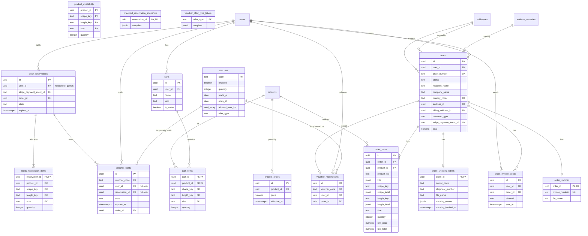

# Pricing, cart and orders

The catalog's source stock is imported from pamsurin-manager into
`product_availability`. A checkout creates a short-lived allocation in
`stock_reservations`; effective availability is the imported quantity less
every active allocation and every paid order. This keeps stock safe under
concurrent checkouts without letting an import restore a unit that is already
reserved or sold.

Dead reservations are purged (`stockReservationMaintenance.ts`, opportunistic:
at most once per process every six hours, started by a checkout reservation,
5000 rows per run): released for a day, or held and expired for a day, with no
`stripe_payment_intent_id`, no `order_id`, and no `gift_offers` row pointing at
them. Items, checkout snapshot, voucher and loyalty holds cascade. A reservation
linked to a PaymentIntent is never purged, so a late signed webhook can still
settle it. Supported by partial `stock_reservations_released_purge_idx
(updated_at) where state = 'released' and stripe_payment_intent_id is null`.
Gift holds (`purpose = 'gift'`) store stock units per variant, like checkout
reservations: a byQuantity pack holds quantity x multiplier.

### `product_prices`

Append-only price history — one flat price per set, independent of shape or
size (a customer picks a shape and a size, but both cost the same). Only the
row with the latest `effective_at` (not in the future) is ever shown to a
customer; `order_items.unit_price` below snapshots it at confirm time, so a
later price change never rewrites a placed order's total.

| Column         | Type                                                      | Notes                                                            |
| -------------- | --------------------------------------------------------- | ---------------------------------------------------------------- |
| `id`           | `uuid` PK                                                 | App-generated, same convention as every other id in this schema. |
| `product_id`   | `uuid not null references products(id) on delete cascade` |                                                                  |
| `price`        | `numeric(10,2) not null check (price > 0)`                | TTC — no VAT handling yet.                                       |
| `effective_at` | `timestamptz not null default now()`                      |                                                                  |

Authored via a `price` key in pamsurin-manager's `data-static.json` (same
place `product-uid` lives) and pushed through the existing `npm run library`
import pipeline — `POST /operation/library-import/sets`' optional `price`
field only inserts a new row when it actually differs from the latest one on
file (`prices.service.ts`'s `setPriceIfChanged`), so re-running the import
with an unchanged price never piles up duplicate rows. On an _existing_ set,
price is only ever applied alongside `update:true` — same gate as every
other field, so a plain `npm run library -- seed` (no `--update`) can
never silently change a price. A brand-new set's initial price is applied
on creation regardless (there's no prior state for `update` to gate).

Index: `product_prices_set_idx (product_id, effective_at desc)`.

### `carts` / `cart_items`

Multi-cart model (`1738000037000_multi_carts.js`). A user owns zero or more
named `carts`; at most one has `is_active` (partial unique index). Checkout
selection (address, billing, courier, express, payment method id, voucher
draft) lives on the cart row — not in `user_preference`.

`confirmOrder` deletes the active cart row if checkout emptied it of every
line, then reactivates another cart when one remains. An ordered-out cart is
finished, so it does not stay as an empty tile. This includes `default`.
While some other cart is the active one and no `default` row remains,
`GET /account/carts` inserts an empty inactive default cart, so the shopper
can switch back to it from "Autres paniers" without adding a product first.
`ensureActiveCart` still creates an active default when the account has no
active cart at all.

`deleteCart` (manual delete from "Autres paniers") is more conservative: a
`kind: 'default'` cart is never actually dropped, only cleared of its lines.
The customer means "empty this", not "remove my main cart", and the row would
just be recreated identical on the next add anyway. Every other kind is
deleted outright, with the same reactivation as above.

| Column                                                | Type                                                                                | Notes                                                                                                                                                                                                                                                                                                                                                                                                                                                                                                                                                                                                                                                                                                                                                                                                                                                                                                                                                                            |
| ----------------------------------------------------- | ----------------------------------------------------------------------------------- | -------------------------------------------------------------------------------------------------------------------------------------------------------------------------------------------------------------------------------------------------------------------------------------------------------------------------------------------------------------------------------------------------------------------------------------------------------------------------------------------------------------------------------------------------------------------------------------------------------------------------------------------------------------------------------------------------------------------------------------------------------------------------------------------------------------------------------------------------------------------------------------------------------------------------------------------------------------------------------- |
| `name`                                                | `text not null`                                                                     | User-editable display name (seeded e.g. `Panier`, `Commander à nouveau CMD-…`). Application enforces max 50 characters on create/rename/import-guest (not a DB check).                                                                                                                                                                                                                                                                                                                                                                                                                                                                                                                                                                                                                                                                                                                                                                                                           |
| `kind`                                                | `text check (kind in ('default','wishlist','rebuy','custom','unconnected','gift'))` | Stable system tag for UI/i18n. The lazy, per-user `wishlist` cart is added by `1738000042000_wishlist_cart.js`; its partial unique index allows at most one per user. `unconnected` (added by `1738000002600_unconnected_cart_kind.js`) parks guest lines the customer neither merged nor named at login; `carts_user_unconnected_uidx` allows at most one per user. `gift` (added by `1788000000000_gift_offers.js`) holds Julie’s promised lines for Marc’s checkout: listed on `GET /account/carts` while the offer is open, excluded from `CART_MAX_PER_USER`, unique `(user_id, gift_offer_id)`, merge/delete → `400 invalid_request`, rename allowed (`kind` stays `gift`), activate allowed. `default`, `wishlist`, `unconnected`, and `gift` do not consume the `CART_MAX_PER_USER` allowance. Rename of a `default` cart flips kind to `custom`; renaming a `wishlist` or `unconnected` cart is rejected (`400 invalid_request`) since their label comes from the kind. |
| `is_active`                                           | `boolean`                                                                           | Exactly one active cart per user when any carts exist. Gift carts may be active so the shop cart shows that promise.                                                                                                                                                                                                                                                                                                                                                                                                                                                                                                                                                                                                                                                                                                                                                                                                                                                             |
| `address_id` / `billing_address_id`                   | `uuid` nullable FK → `addresses` `on delete set null`                               |                                                                                                                                                                                                                                                                                                                                                                                                                                                                                                                                                                                                                                                                                                                                                                                                                                                                                                                                                                                  |
| `same_as_billing` / `express`                         | `boolean`                                                                           |                                                                                                                                                                                                                                                                                                                                                                                                                                                                                                                                                                                                                                                                                                                                                                                                                                                                                                                                                                                  |
| `courier_code` / `payment_method_id` / `voucher_code` | `text` nullable                                                                     | `payment_method_id` is a Stripe `pm_…` or a checkout sentinel (`paypal`, `bancontact`, `google_pay`, `apple_pay`).                                                                                                                                                                                                                                                                                                                                                                                                                                                                                                                                                                                                                                                                                                                                                                                                                                                               |

`cart_items` PK is `(cart_id, product_id, shape_key, length_key, size)` — ownership
is via the cart, not a `user_id` column on the line. Adding the same
identity again adds to `quantity`; a different shape, length or size is a
separate line. Nails use real shape+length+size; accessories use
`shape_key=''`, `length_key=''` and `size=''`
(API path sentinel `-` for empty segments). `pack_key` is **not** part of the
PK: switching `x5`/`x10` on a `byQuantity` accessory updates the same line
instead of adding a second one.

| Column       | Type                                              | Notes                                                                                  |
| ------------ | ------------------------------------------------- | -------------------------------------------------------------------------------------- |
| `shape_key`  | `text not null default ''`                        | Nail shape variant, or `''` for accessories.                                           |
| `length_key` | `text not null default ''`                        | Nail length within that shape, or `''` for accessories.                                |
| `size`       | `text not null default ''`                        | `XS`/`S`/`M`/`L` for nails, or `''` for accessories. All three empty or all three set. |
| `pack_key`   | `text not null default ''`                        | `byQuantity` pack (`x5`, `x10`, …). Empty for nails and default accessories.           |
| `quantity`   | `integer not null default 1 check (quantity > 0)` | Pack count for `byQuantity`; stock units for everything else.                          |
| `origin`     | `text not null default 'user'`                    | `user` \| `rule` — rule lines are gift sync from `cart_rules`.                         |
| `locked`     | `boolean not null default false`                  | Gift lines are locked (PATCH/DELETE → `line_locked`).                                  |
| `rule_id`    | `uuid` nullable FK → `cart_rules`                 | Set for `origin = rule` lines.                                                         |
| `comment`    | `text` nullable, 1–500 chars                      | Customer note of the cart card (`1791100000000_line_comments.js`). Same value on every line of one product+shape+length; a new size line inherits it. Copied to `order_items.comment` at checkout. |

FK `product_id` → `products(id) on delete cascade`. Variant validity for
nails is enforced in the account cart routes (must exist in
`product_shape_lengths` — see `resolveCartLineVariant`, which also fills in
the shape's default length when a request omits `lengthKey`, as every
request does today).

Index: `cart_items_cart_idx (cart_id)`. Soft cap: `CART_MAX_PER_USER` (env).

### `cart_compositions` / `cart_composition_items`

A composed nail set in a cart. The parent is never a `cart_items` row and
never references a catalogue product. Added by
`1790200000000_compose_nail_set.js`.

| Column (parent) | Type                                                   | Notes                                                                                                                                                 |
| --------------- | ------------------------------------------------------ | ----------------------------------------------------------------------------------------------------------------------------------------------------- |
| `id`            | `uuid` PK                                              |                                                                                                                                                       |
| `cart_id`       | `uuid not null references carts(id) on delete cascade` |                                                                                                                                                       |
| `size`          | `text` (`XS`/`S`/`M`/`L`)                              | Shared by every nail in the composition.                                                                                                              |
| `quantity`      | `integer not null default 1 check (quantity > 0)`      | Composition quantity, not nail count.                                                                                                                 |
| `editing`       | `boolean not null default false`                       | Customer left modify mode without update/cancel. At most one editing composition per cart (partial unique index). Checkout refuses while any is true. |
| `comment`       | `text` nullable, 1–500 chars                           | Customer note of the set (`1791100000000_line_comments.js`). Copied to `order_items.comment` at checkout. |

| Column (child)             | Type                                                               | Notes                                                                                      |
| -------------------------- | ------------------------------------------------------------------ | ------------------------------------------------------------------------------------------ |
| `composition_id`           | `uuid not null references cart_compositions(id) on delete cascade` |                                                                                            |
| `position`                 | `integer not null check (position >= 0)`                           | Display order. PK with `composition_id`.                                                   |
| `product_id`               | `uuid not null references products(id) on delete cascade`          | Must be `nail_single`.                                                                     |
| `shape_key` / `length_key` | `text not null`                                                    | Per nail.                                                                                  |
| `finger`                   | `text not null`                                                    | `left-thumb` … `right-pinky`. Unique per composition.                                      |
| `variation_key`            | `text not null default ''`                                         | Variation option of that nail; `''` when the nail has none. Priced and checked per option. |

### `cart_rules`

Permanent storefront rules authored only via `npm run cart-rule` / OPS
(`/operation/cart-rules`). No manager JSON.

| Column           | Type          | Notes                                                                                                                                                                                  |
| ---------------- | ------------- | -------------------------------------------------------------------------------------------------------------------------------------------------------------------------------------- |
| `id`             | `uuid` PK     |                                                                                                                                                                                        |
| `code`           | `text unique` | e.g. `tip-pot`, `nail-qty-tier`, `ship-franco` (lowercase)                                                                                                                             |
| `kind`           | `text`        | `gift_per_nail_set` \| `nail_qty_percent_tiers` \| `free_shipping_above` (`gift_per_composition` removed by `1790500000000_cart_rule_min_nails.js`) |
| `enabled`        | `boolean`     |                                                                                                                                                                                        |
| `priority`       | `integer`     | Lower runs first among kinds that stack in evaluate                                                                                                                                    |
| `forbid_voucher` | `boolean`     | When the rule **applies**, vouchers are rejected                                                                                                                                       |
| `params`         | `jsonb`       | Kind-specific (validated in `cartRules.service`)                                                                                                                                       |

`gift_per_nail_set` params `{ productUid, qtyPerNailSetUnit, minNails }`
(`minNails` 1 to 10). A catalogue nail set is one unit. A composed set is one
unit when it holds at least `minNails` nails, counted by its quantity. Two
gift rules naming the same product add up on one locked line, filed under the
first rule by priority. `nail_qty_percent_tiers` params
`{ tiers, minNails }` uses the same unit: catalogue sets always count, a
composed set counts from `minNails` nails, and the percent applies to the
line totals of the units that count. A shorter composed set counts as zero
and is not discounted.

Pipeline (in `priceCheckout`): sync gifts → price lines → shipping list fee →
apply rules → voucher last (unless `forbid_voucher`). Order totals:

`sum(line_total) + shipping_fee - rules_item_discount - voucher_item_discount - voucher_shipping_discount`

where `shipping_fee` is the **charged** fee after franco (0 when free) and
`shipping_list_fee` keeps the pre-franco list price for UI/email/invoice.
The list fee is resolved from `courier_packets.price` / `express_price`
(jsonb: scalar or per-country map) for the delivery address's country;
missing resolution fails checkout (`shipping_price_unavailable` /
`express_unavailable`). Franco (`free_shipping_above`) compares paid-item
subtotal after the nail-qty volume remise
(`merchandiseSubtotal - rules_item_discount`) to that **delivery country's**
threshold (`params.thresholdsByCountry`). A country missing from the map
never unlocks franco. The courier list fee is never part of that total; promo
vouchers run after and do not change whether franco applies.

`cart_rebuy_snapshots` stores a short-lived (30m) one-shot cancel token after
`POST /account/carts/rebuy` so the drawer "Annuler" can restore pre-merge
state or delete a cart created with `mode=new`. `consumed_at` is stamped when
the token is spent, which is what makes it one-shot: the row is kept rather
than deleted so a double-click on "Annuler" is a clean no-op instead of a
confusing 404, and it ages out on `expires_at` like any other token: each new
snapshot deletes every row a day past its `expires_at`. A `mode=merge` payload
also lists the cart's `compositionIds` so cancelling removes the composed sets
the rebuy added.

### `product_availability` / stock reservations

`product_availability.quantity` is the **source quantity** imported from
`pamsurin-manager` — it is never decremented by checkout. A missing
`(product_id, shape_key, length_key, size)` row means zero available. Nails
stock per shape×length×size — a different length is a physically different
product with its own count, so the two never share a number; accessories use
a single row with `shape_key=''`, `length_key=''` and `size=''` (the unit
pool). `byQuantity` packs do not get their own availability rows — checkout
reserves `pack quantity × multiplier` units against that one row.
Customer-facing availability subtracts all `stock_reservation_items` whose parent is either
`held` and not expired, or `consumed`.

`stock_reservations` records one checkout or gift-promise attempt. Column
`purpose` is `checkout` (default) or `gift` (`1788000000000_gift_offers.js`).
It is `held` for
`STOCK_RESERVATION_TTL` (10 minutes by default), then becomes `consumed` when
its Stripe PaymentIntent succeeds — or when an explicitly confirmed
voucher-covered zero-total order is written; a failed,
replaced, expired, edited-away, or cancelled allocation is `released` and no
longer counts against stock. `stripe_payment_intent_id` and `order_id` are
unique idempotency/traceability links. `stock_reservation_items` holds the
exact set/shape/length/size/quantity allocation for that attempt; `quantity`
is **stock units** (for `byQuantity` accessories, pack count × multiplier).
Its primary key is `(reservation_id, product_id, shape_key, length_key, size)`
— kept in lockstep with `cart_items`' own key, for the same reason: a checkout
can reserve more than one line for the same gallery set. Accessories still
allocate against `''/''/''`. The operations-only order-delete commands remove the
consumed reservation with an order, releasing its allocation; they never
cancel or refund the corresponding Stripe payment.

`checkout_reservation_snapshots` is a one-row encrypted commercial snapshot
for each new reservation: server-validated address/billing address, courier,
fixed item/price/rule/voucher state and total. It is saved in the same
transaction as stock allocation, before a card or redirect payment can be
confirmed. Finalization creates the order from this snapshot rather than
rereading the mutable cart; an unsuccessful or cancelled payment releases the
parent reservation and cascades the snapshot.

If Stripe settles while the normal order transaction cannot complete, the
snapshot is instead used to create an order with `status = 'need_review'` and a
human-readable `status_reason`. A review that can safely Continue consumes the
stock/promotion/loyalty holds so the paid items remain allocated. A blocked
review releases resources that were not already consumed, because its only
valid outcome is Cancel. The customer can still see the order, but the
customer-facing UI intentionally renders no status badge for this internal
exception. No Stripe cancellation or refund is performed automatically. The
browser-admin endpoint `POST /admin/orders/:id/need-review-resolution` is the
only resolver. Continue verifies the PaymentIntent without capturing; Cancel
is the explicit administrator-triggered cancellation/full-refund action. The
local transition is recorded only after Stripe succeeds. There is no payment
reconciliation table, worker, cron, automatic cancellation, or automatic
refund.

### `orders`

Status meanings, graphs, payment capture, and who may change an order are in
[Order lifecycle](../orders.md). This section is the table and column contract.

| Column                                                                                                                                                                                           | Type                                                                                                                                                                    | Notes                                                                                                                                                                                                                                                                                                                                                                                                                                                                                                                                                                                                                                                                                                                                                                                                                                                                                                                                                                                                                                                                                                                  |
| ------------------------------------------------------------------------------------------------------------------------------------------------------------------------------------------------ | ----------------------------------------------------------------------------------------------------------------------------------------------------------------------- | ---------------------------------------------------------------------------------------------------------------------------------------------------------------------------------------------------------------------------------------------------------------------------------------------------------------------------------------------------------------------------------------------------------------------------------------------------------------------------------------------------------------------------------------------------------------------------------------------------------------------------------------------------------------------------------------------------------------------------------------------------------------------------------------------------------------------------------------------------------------------------------------------------------------------------------------------------------------------------------------------------------------------------------------------------------------------------------------------------------------------- |
| `id`                                                                                                                                                                                             | `uuid` PK                                                                                                                                                               | App-generated.                                                                                                                                                                                                                                                                                                                                                                                                                                                                                                                                                                                                                                                                                                                                                                                                                                                                                                                                                                                                                                                                                                         |
| `user_id` / `guest_email` / `owner_deleted_at`                                                                                                                                                   | `uuid null` FK → `users.id` / `text null` (PII-encrypted) / `timestamptz null`                                                                                          | An order has exactly one of **three** ownership states, enforced by `orders_owner_chk`: an account order (`user_id` set), a guest order (`guest_email` set), or an **orphan** (`owner_deleted_at` set, both others null). `guest_email` is populated for every unauthenticated checkout (`POST /checkout/guest/*`, `confirmGuestOrder`), including when an account already uses that current email — confirm never auto-attaches because the order snapshot includes a visible delivery address. A still-unlinked guest can attach via a 24h manage-order email token (`POST /auth/manage-guest-order`) or `POST /account/guest-orders/:id/claim` (integrity token, within `GUEST_ORDER_CLAIM_WINDOW`). Orphan is the terminal state: `1787380000000_order_customer_snapshot_and_orphan.js` moves an order there when its account is permanently deleted, dropping `guest_email` so **neither claim path can ever surface it again** — a new account registered at the same address gets nothing back. `orders_owner_transition_guard` permits only guest→account and account→orphan, and freezes ownership otherwise. |
| `order_number`                                                                                                                                                                                   | `text not null unique default ('CMD-' \|\| lpad(nextval('orders_number_seq')::text, 6, '0'))`                                                                           | The one id in this schema generated by a real Postgres sequence rather than app code — a short, typeable, race-free customer/support reference (`CMD-000001`), not an opaque identifier like every other id here.                                                                                                                                                                                                                                                                                                                                                                                                                                                                                                                                                                                                                                                                                                                                                                                                                                                                                                      |
| `status`                                                                                                                                                                                         | `text not null default 'confirmed' check (status in ('confirmed','in_preparation','to_send','sent','disponible','received','cancelled','need_review','return_review'))` | `need_review` is an internal checkout/payment exception. `return_review` is a shipped parcel whose unclaimed/refused/return-to-sender signal awaits a human decision. Operations cannot manufacture or resolve either exception. A resolved return becomes `cancelled`; a dismissed false signal restores its prior `sent`/`disponible` status.                                                                                                                                                                                                                                                                                                                                                                                                                                                                                                                                                                                                                                                                                                                                                                        |
| `status_reason`                                                                                                                                                                                  | `text nullable`                                                                                                                                                         | Internal explanation, required and non-blank while `status = 'need_review'`; returned only by browser-admin detail, never customer payloads.                                                                                                                                                                                                                                                                                                                                                                                                                                                                                                                                                                                                                                                                                                                                                                                                                                                                                                                                                                           |
| `need_review_blocked`                                                                                                                                                                            | `boolean not null default false`                                                                                                                                        | Prevents Continue when ownership/amount/payment-method validation failed or stock/promotion/loyalty could not remain safely allocated. Cancel stays available.                                                                                                                                                                                                                                                                                                                                                                                                                                                                                                                                                                                                                                                                                                                                                                                                                                                                                                                                                         |
| `need_review_resolved_at` / `need_review_resolved_by` / `need_review_resolution`                                                                                                                 | `timestamptz` / `uuid references users(id) on delete set null` / `continue\|cancel`                                                                                     | Audit of the administrator's explicit resolution. Null until resolved.                                                                                                                                                                                                                                                                                                                                                                                                                                                                                                                                                                                                                                                                                                                                                                                                                                                                                                                                                                                                                                                 |
| `stripe_resolution`                                                                                                                                                                              | `jsonb nullable`                                                                                                                                                        | Audited outcome (`verified`, `canceled`, `refunded`, or `already_refunded`, PI status, optional refund id/status).                                                                                                                                                                                                                                                                                                                                                                                                                                                                                                                                                                                                                                                                                                                                                                                                                                                                                                                                                                                                     |
| `recipient_name` / `company_name` / `line1` / `line2` / `delivery_notes` / `postal_code` / `city` / `country_code` / `phone`                                                                     |                                                                                                                                                                         | A **snapshot** of the chosen (`kind='livraison'`) address at confirm time, not a live join — editing a saved address later must never rewrite a placed order's shipping details. `company_name` added by `1738000034000_address_company_name.js`, mirroring `addresses.company_name`; `recipient_name` dropped its `not null` in that same migration (check constraint `orders_recipient_or_company_chk` requires at least one of the two, same rule as `addresses`). `delivery_notes` — complementary delivery instructions; Mondial Relay sticker XML fills `AddressAdd3` from this snapshot for home and point-relais labels.                                                                                                                                                                                                                                                                                                                                                                                                                                                                                       |
| `address_id`                                                                                                                                                                                     | `uuid references addresses(id) on delete set null`                                                                                                                      | Traceability only; never re-read for display.                                                                                                                                                                                                                                                                                                                                                                                                                                                                                                                                                                                                                                                                                                                                                                                                                                                                                                                                                                                                                                                                          |
| `billing_address_id` / `billing_recipient_name` / `billing_company_name` / `billing_line1` / `billing_line2` / `billing_postal_code` / `billing_city` / `billing_country_code` / `billing_phone` | `uuid references addresses(id) on delete set null` / `text` snapshot columns                                                                                            | Added by `1738000033000_address_kind_and_billing.js` (billing snapshot) and `1738000034000_address_company_name.js` (`billing_company_name`, and dropped `billing_recipient_name`'s `not null` — same at-least-one-of-two check as the shipping columns, `orders_billing_recipient_or_company_chk`). Always populated, never null as a group — mirrors the shipping columns above when the customer chose "same as delivery" (`billing_same_as_shipping = true`), otherwise snapshots a distinct `kind='facturation'` address chosen at checkout. Backfilled for every order that predates this column from its own shipping columns (with `billing_same_as_shipping = true`), since every order before this feature necessarily used its delivery address for billing too.                                                                                                                                                                                                                                                                                                                                            |
| `billing_same_as_shipping`                                                                                                                                                                       | `boolean not null default true`                                                                                                                                         | Added by `1738000033000_address_kind_and_billing.js`. Informational — the billing columns above are always fully populated regardless, so invoice/export code never needs to branch on this; it's what lets the front's order-detail views show a second "Adresse de facturation" block only when it's actually distinct.                                                                                                                                                                                                                                                                                                                                                                                                                                                                                                                                                                                                                                                                                                                                                                                              |
| `customer_type`                                                                                                                                                                                  | `text not null default 'particulier' check (customer_type in ('particulier','entreprise'))`                                                                             | Added by `1738000034000_address_company_name.js`. Derived from whichever address serves as this order's billing identity — the `billing_*` columns' own `company_name` when `billing_same_as_shipping = false`, otherwise the shipping `company_name`. Re-derived on `billing_address_change` revisions. Feeds a later VAT/TVA feature; not shown to the customer. Folded into `content_hash` alongside `company_name`/`billing_company_name`.                                                                                                                                                                                                                                                                                                                                                                                                                                                                                                                                                                                                                                                                         |
| `network_code`                                                                                                                                                                                   | `text references delivery_networks(code)`                                                                                                                               | Added by `1738000009000_courier.js` — **singular**, unlike the address it was chosen from (which can belong to several networks, see `address_networks`): it's a snapshot of whichever one network actually matched the chosen courier for this shipment.                                                                                                                                                                                                                                                                                                                                                                                                                                                                                                                                                                                                                                                                                                                                                                                                                                                              |
| `pickup_point`                                                                                                                                                                                   | `jsonb`                                                                                                                                                                 | Added by `1738000015000_pickup_points.js`. Immutable snapshot of the matching address `pickup_points[network_code]`, when one exists. It preserves the actual locker/provider reference needed for carrier fulfillment even if the saved address is later edited.                                                                                                                                                                                                                                                                                                                                                                                                                                                                                                                                                                                                                                                                                                                                                                                                                                                      |
| `courier_id`                                                                                                                                                                                     | `uuid references couriers(id) on delete set null`                                                                                                                       | Added by `1738000009000_courier.js`. Traceability only, like `address_id`.                                                                                                                                                                                                                                                                                                                                                                                                                                                                                                                                                                                                                                                                                                                                                                                                                                                                                                                                                                                                                                             |
| `courier_code` / `courier_name` (`jsonb`, trilingual) / `packet_key` / `express`                                                                                                                 |                                                                                                                                                                         | Added by `1738000009000_courier.js` — snapshot of the courier/packet-tier chosen at confirm time. `packet_key` is never a customer choice: `confirmOrder` derives it itself from customer-added nail-set quantity (accessories count as 0; see `couriers`/`courier_packets`) and freezes it here, same as `unit_price` on `order_items` — a later item-quantity edit never recomputes it.                                                                                                                                                                                                                                                                                                                                                                                                                                                                                                                                                                                                                                                                                                                              |
| `shipping_fee`                                                                                                                                                                                   | `numeric(10,2) not null default 0 check (shipping_fee >= 0)`                                                                                                            | Added by `1738000009000_courier.js`. Frozen at confirm time alongside `packet_key`/`express`. **Charged** fee after cart rules (0 when free-shipping rule applies).                                                                                                                                                                                                                                                                                                                                                                                                                                                                                                                                                                                                                                                                                                                                                                                                                                                                                                                                                    |
| `shipping_list_fee`                                                                                                                                                                              | `numeric(10,2) not null default 0`                                                                                                                                      | List courier fee before franco (for strikethrough UI / email / invoice).                                                                                                                                                                                                                                                                                                                                                                                                                                                                                                                                                                                                                                                                                                                                                                                                                                                                                                                                                                                                                                               |
| `rules_item_discount`                                                                                                                                                                            | `numeric(10,2) not null default 0`                                                                                                                                      | Nail qty % tier discount amount.                                                                                                                                                                                                                                                                                                                                                                                                                                                                                                                                                                                                                                                                                                                                                                                                                                                                                                                                                                                                                                                                                       |
| `cart_rules_snapshot`                                                                                                                                                                            | `jsonb not null default '{}'`                                                                                                                                           | Applied rules + effects frozen at confirm.                                                                                                                                                                                                                                                                                                                                                                                                                                                                                                                                                                                                                                                                                                                                                                                                                                                                                                                                                                                                                                                                             |
| `voucher_code` / `voucher_item_discount` / `voucher_shipping_discount`                                                                                                                           | `text nullable` / `numeric(10,2) default 0`                                                                                                                             | Added by `1738000017000_vouchers.js`. Immutable promotion snapshot. The code keeps its own audit entry in `voucher_redemptions`; the two discount columns distinguish an item-price reduction from free delivery.                                                                                                                                                                                                                                                                                                                                                                                                                                                                                                                                                                                                                                                                                                                                                                                                                                                                                                      |
| `total`                                                                                                                                                                                          | `numeric(10,2) not null check (total >= 0)`                                                                                                                             | `sum(order_items.line_total) + shipping_fee - rules_item_discount - voucher discounts`, capped at zero — `shipping_fee` / rules fields themselves are never recomputed post-confirm. A zero-total order is voucher/rules-covered and is confirmed without Stripe.                                                                                                                                                                                                                                                                                                                                                                                                                                                                                                                                                                                                                                                                                                                                                                                                                                                      |
| `stripe_payment_intent_id`                                                                                                                                                                       | `text`, nullable, unique                                                                                                                                                | Added by `1738000010000_stripe_payments.js`. Both the payment record and the idempotency key for `confirmOrder` — a webhook retry or a race between `/checkout/finalize` and the webhook for the same PaymentIntent finds the already-created order via this unique index and returns it as-is rather than double-charging the cart. `'free:<reservationId>'` for a voucher-covered zero-total order, which never touches Stripe at all — see `orders.service.ts`'s `confirmOrder`.                                                                                                                                                                                                                                                                                                                                                                                                                                                                                                                                                                                                                                    |
| `payment_capture_status`                                                                                                                                                                         | `text not null check (… in ('authorized','captured','not_required','canceled','expired'))`                                                                              | Added by `1738000040000_order_payment_capture.js`; `expired` by `1738000041000_payment_capture_expired.js`. Card and PayPal authorize at checkout (`authorized`, `capture_method=manual`); Bancontact settles immediately (`captured`, `capture_method=automatic`). Ops `set-status` captures before `in_preparation` (unless `--no-payment`) or `to_send` when still authorized. Free/voucher €0 → `not_required`. Cancel before capture → `canceled` (PI canceled). Auth window ended before capture → `expired` (funds never taken; order lifecycle unchanged). Pre-existing rows backfilled as `captured` / `not_required`.                                                                                                                                                                                                                                                                                                                                                                                                                                                                                        |
| `payment_operation` / `payment_operation_started_at`                                                                                                                                             | `capture\|cancel` nullable / `timestamptz` nullable                                                                                                                     | Internal cross-process serialization. The pair is set and committed before Stripe capture/cancel I/O, then cleared on finalization. This prevents opposite operations from racing without retaining a PostgreSQL row lock or pool connection during the network call. A retry resumes the same Stripe idempotency key; no cron or automatic Stripe decision consumes this marker. Never exposed to customers.                                                                                                                                                                                                                                                                                                                                                                                                                                                                                                                                                                                                                                                                                                          |
| `payment_method_type` / `payment_card_brand` / `payment_card_last4`                                                                                                                              | `text nullable` check `card\|paypal\|bancontact\|free` / `text` / `text`                                                                                                | Immutable confirm-time snapshot of **how** the customer paid (or that payment was not required). Card brand/last4 filled from the PaymentIntent's payment method at settle; PayPal / Bancontact / free leave brand+last4 null. `bancontact` added by `1787460000000_order_payment_method_bancontact.js`. Null type is only meaningful on DBs that predate this column (UI/PDF show capture status only).                                                                                                                                                                                                                                                                                                                                                                                                                                                                                                                                                                                                                                                                                                               |
| `content_hash`                                                                                                                                                                                   | `text nullable`                                                                                                                                                         | Added by `1738000021000_order_content_hash.js`. HMAC-SHA256 (keyed by `JWT_SECRET`) of the order's current snapshot fields plus its items — see `orders.service.ts`'s `computeOrderContentHash`. Set once in `confirmOrder` (implicit revision 0), then rewritten by each later `order_revisions` row to that revision's chained hash (`HMAC(prevHash + snapshotHash)`). Null for orders confirmed before this column existed — never backfilled. Exposed to the frontend as a shortened `integrityToken` (see `account.routes.ts`'s `toPublicOrder` / `formatIntegrityToken`), never the raw hash.                                                                                                                                                                                                                                                                                                                                                                                                                                                                                                                    |
| `revision_lock_token` / `revision_lock_until` / `revision_lock_user_id` / `revision_lock_baseline_hash`                                                                                          | `uuid` / `timestamptz` / `uuid references users(id) on delete set null` / `text`                                                                                        | Added by `1738000039000_order_revisions.js`. Customer edit lock: while `revision_lock_until > now()`, `setStatus` refuses with `order_revision_locked`. If the TTL elapsed but lock columns remain, `setStatus` refuses with `order_revision_lock_stale` unless `--bypass-lock-edit` / `bypassLockEdit`. `baseline_hash` stores `content_hash` at acquire so a save after TTL expiry can still commit iff nothing else changed the order. TTL from `ORDER_REVISION_LOCK_TTL` (default 30m).                                                                                                                                                                                                                                                                                                                                                                                                                                                                                                                                                                                                                            |
| `placed_as_guest`                                                                                                                                                                                | `boolean not null default false`                                                                                                                                        | Added by `1787320000000_guest_order_manage.js`. True for every guest-checkout insert, kept true after token or integrity-code claim so origin stays visible. Connected checkout stays false. Existing unlinked guest rows were backfilled.                                                                                                                                                                                                                                                                                                                                                                                                                                                                                                                                                                                                                                                                                                                                                                                                                                                                             |
| `guest_email_lookup`                                                                                                                                                                             | `text null`                                                                                                                                                             | Added by `1787380000001_orders_guest_email_lookup.js`. HMAC blind index over `guest_email` (`emailLookupHash`), so both claim paths match in SQL instead of decrypting every guest order in the table and comparing in Node — `attachUnlinkedGuestOrdersForEmail` runs on the login path, so that scan grew with lifetime guest-order count. Null exactly when `guest_email` is, and nulled together with it on claim. Backfilled by `POST /operation/database-migrate` (an HMAC of the plaintext cannot be computed in SQL — no pgcrypto on LWS). Index `orders_guest_email_lookup_idx` is partial on `guest_email is not null`, so orphans are unreachable by lookup.                                                                                                                                                                                                                                                                                                                                                                                                                                                |
| `customer_email` / `customer_first_name` / `customer_last_name`                                                                                                                                  | `text not null` / `text null` / `text null` — all **ciphertext**                                                                                                        | Added by `1787380000000`. Who placed the order, snapshotted at insert by the `orders_customer_identity_snapshot` trigger (from `users` for an account order, from `guest_email` for a guest one) rather than by each call site, so no future insert path can forget them. This is what lets an account be deleted without losing who bought what: an orphan still answers who, when, where and how. Deliberately **not** blind-indexed — an orphan must not be findable by email.                                                                                                                                                                                                                                                                                                                                                                                                                                                                                                                                                                                                                                      |
| `language`                                                                                                                                                                                       | `text null` check `fr\|en\|th\|es\|it\|nl\|pt`                                                                                                                          | Added by `1787320000000_guest_order_manage.js`. Guest-checkout locale snapshot for later status/invoice emails. Null on connected-checkout orders (those use the account language preference).                                                                                                                                                                                                                                                                                                                                                                                                                                                                                                                                                                                                                                                                                                                                                                                                                                                                                                                         |
| `admin_verified_at`                                                                                                                                                                              | `timestamptz` nullable                                                                                                                                                  | Added by `1787330000000_order_admin_verified.js`. One-way admin acknowledgement for terminal statuses only (`received` / `cancelled`). `null` = still needs attention (counts toward hub badges); non-null stamps when an administrator verified the order. Never set automatically on status transitions; customer-facing APIs ignore this column.                                                                                                                                                                                                                                                                                                                                                                                                                                                                                                                                                                                                                                                                                                                                                                    |
| `sent_at`                                                                                                                                                                                        | `timestamptz` nullable                                                                                                                                                  | Added by `1787440000000_order_sent_at.js`. Physical handoff time when the order enters `sent`, retained when later carrier transitions move it to `disponible` or `received`. Existing rows still in `sent` were safely backfilled from `status_updated_at`; later historical rows remain `null` because their actual send time cannot be reconstructed reliably.                                                                                                                                                                                                                                                                                                                                                                                                                                                                                                                                                                                                                                                                                                                                                      |
| `gift_offer_id`                                                                                                                                                                                  | `uuid` nullable unique FK → `gift_offers`                                                                                                                               | Added by `1788000000000_gift_offers.js`. Set when Marc’s checkout settles a gift promise. At most one order per offer.                                                                                                                                                                                                                                                                                                                                                                                                                                                                                                                                                                                                                                                                                                                                                                                                                                                                                                                                                                                                 |
| `gift_snapshot`                                                                                                                                                                                  | `jsonb` nullable                                                                                                                                                        | Encrypted `{ enc }` frozen giver/receiver names, ceilings, `giverEmail`, and `receiverEmail` (the latter from confirm). Public order JSON decrypts to `gift` without those emails; admin and Mondial Relay read them from the snapshot. Invoice PDF titles the block **Commande cadeau**. Distinct from cart-rule “Cadeaux offerts” lines.                                                                                                                                                                                                                                                                                                                                                                                                                                                                                                                                                                                                                                                                                                                                                                                                                                            |
| `confirmed_at`                                                                                                                                                                                   | `timestamptz not null default now()`                                                                                                                                    |                                                                                                                                                                                                                                                                                                                                                                                                                                                                                                                                                                                                                                                                                                                                                                                                                                                                                                                                                                                                                                                                                                                        |
| `status_updated_at`                                                                                                                                                                              | `timestamptz not null default now()`                                                                                                                                    | Bumped on every status transition.                                                                                                                                                                                                                                                                                                                                                                                                                                                                                                                                                                                                                                                                                                                                                                                                                                                                                                                                                                                                                                                                                     |
| `created_at` / `updated_at`                                                                                                                                                                      | `timestamptz not null default now()`                                                                                                                                    | Standard pair, present on nearly every table in this schema. `created_at` here is effectively the same instant as `confirmed_at`; a settled-payment exception is inserted directly as `need_review`, not as an earlier checkout draft.                                                                                                                                                                                                                                                                                                                                                                                                                                                                                                                                                                                                                                                                                                                                                                                                                                                                                 |

While `status` is `confirmed` or `in_preparation`, the owning customer can
amend delivery (same courier, no price change) and billing addresses under
an edit lock that blocks ops `set-status` (active or stale). Customer cancel
is available while `confirmed` + `payment_capture_status=authorized`, or for
a zero-total `payment_capture_status=not_required` order while `confirmed` or
`in_preparation`.
An admin can set a
pre-shipment order (`confirmed`, `in_preparation`, or `to_send`) to
`cancelled`, which deletes its consumed reservation and restores stock; it
does not refund Stripe or void a carrier label.

Indexes: `orders_user_history_idx (user_id, status, confirmed_at desc, created_at desc)` (`orders_user_idx (user_id, status)` was a strict prefix of it and was dropped by `1790000000000_fk_indexes.js`; it backs the `user_id` foreign key); `orders_user_confirmed_idx (user_id, confirmed_at desc, id desc)` (customer order history ordering) and `orders_status_created_idx (status, created_at)` (admin list per status, tracking cron), both added by `1791300000000_index_and_fk_tuning.js`; partial `orders_attention_active_idx (status) where status in ('confirmed','disponible')`, `orders_need_review_attention_idx (created_at) where status = 'need_review'`, `orders_return_review_attention_idx (status_updated_at) where status = 'return_review'`, `orders_payment_operation_idx (payment_operation, payment_operation_started_at) where payment_operation is not null`, and `orders_attention_unverified_terminal_idx (status) where status in ('received','cancelled') and admin_verified_at is null` (admin hub badge counts). Partial `orders_need_review_resolved_by_idx (need_review_resolved_by) where not null` exists for the foreign key onto `users`, not for a query: without it every account deletion scans this table.

### `payment_auth_expiry_spy_sends`

Idempotent `(order_id, day)` dedup for the payment-authorization-expiry-spy
cron, mirroring gift's `gift_reminder_sends`. One row means the owner alert
already went out for that order on that day; `ON DELETE CASCADE` with
`orders`. See [cron/README.md](../cron/README.md#payment-auth-expiry-spy-cron)
for the estimated-expiry math (Stripe exposes no exact hold expiry for
manual capture).

### `order_return_cases` / `order_return_stock_actions`

`order_return_cases` is the
append-only audit around one detected parcel return. A partial unique index on
`order_id` allows at most one `open`/`refund_pending` case, while retaining
dismissed and resolved history.
`order_return_cases_order_created_idx (order_id, created_at desc)` keeps latest
case and dismissed-evidence checks bounded per order. It records the
previous fulfillment status,
return type (`unclaimed|refused|other`), detection source/evidence, resolution
state, administrator decision/reasons, selected refund and retained-courier
amounts in integer cents, Stripe identifiers/status, actor/timestamps, and
retryable final-email state.
`loyalty_earn_retained_cents` (default 0) is earn from the returned order
already spent elsewhere, deducted from the Stripe refund. `resolution_request`
freezes an in-flight refund choice so a retry cannot silently change an
already submitted Stripe action.

`order_return_stock_actions` records every positive physical quantity restored
by a resolved case. Its composite primary key prevents a variant being applied
twice within the same resolution. A product deleted before review leaves a
null `product_id` audit value and cannot be restored automatically.

### `order_fulfillment_stock`

Immediately before the
`sent` transition deletes a consumed stock reservation, its exact physical
`stock_reservation_items` are copied here by order/product/variant. This is
necessary for quantity-pack accessories, where an order-line pack count is not
the number of physical units removed. `shipped_quantity` is immutable;
`restocked_quantity` advances idempotently and cannot exceed it. Orders sent
before this ledger existed have no exact row and therefore require explicit
manual physical quantities during return review.

### `guest_order_dismissals`

Added by `1787270000000_guest_order_claims.js`. Primary key
`(user_id, order_id)` records an account's “not my order” decision for an
otherwise email-matching guest order. It hides only that candidate for that
account; it never changes the order or guest contact data.

### `guest_order_manage_tokens`

Added by `1787320000000_guest_order_manage.js`. 24h inbox-proof tokens
emailed on still-unlinked guest confirmation/status/shipped/invoice mail,
and also when remembered guest address/card rows are still unclaimed
(`EMAIL_CONFIRMATION_TOKEN_TTL`). Each send inserts a new token; older unused
tokens for the same order stay valid until their own expiry. First successful
`POST /auth/manage-guest-order` marks all tokens for the attached orders used.
Email and `email_lookup` are PII-encrypted / HMAC-indexed like confirmation
tokens. `gdpr_consent_version` + `language` are stashed so consume can create
a passwordless verified account when none exists.

| Column                 | Type                   | Notes                                                |
| ---------------------- | ---------------------- | ---------------------------------------------------- |
| `id`                   | `uuid` PK              | App-generated                                        |
| `order_id`             | `uuid not null`        | FK `orders` on delete cascade                        |
| `email`                | `text not null`        | Encrypted PII                                        |
| `email_lookup`         | `text not null`        | HMAC index for lookup                                |
| `token_hash`           | `text not null` UK     |                                                      |
| `gdpr_consent_version` | `text not null`        | Stashed for passwordless account create              |
| `language`             | `text not null`        | `fr` \| `en` \| `th` \| `es` \| `it` \| `nl` \| `pt` |
| `expires_at`           | `timestamptz not null` |                                                      |
| `used_at`              | `timestamptz` null     | Set when consumed                                    |
| `created_at`           | `timestamptz not null` | Default `now()`                                      |

Index: `guest_order_manage_tokens_order_idx (order_id)`.

### `guest_saved_addresses` / `guest_saved_cards`

Added by `1787350000000_guest_saved_checkout.js`. Pending remembered guest
checkout rows, keyed by `email_lookup`. Inserted only when the guest opted
in (`savedForFuture` / `rememberCard`) and the order confirmed. Copied onto
an account solely by `POST /auth/manage-guest-order` (each pending address
and card is copied as its own row; a remembered card is moved onto the
account's Stripe customer). Independent login/register does not copy these
rows. `delete_after` matches
`EMAIL_CONFIRMATION_TOKEN_TTL` and is refreshed when a new manage token is
issued for that email. The production cron
`POST /operation/process-guest-saved-cleanup` deletes expired rows and
detaches/deletes the pending Stripe customer for cards.

`network_codes` (`jsonb`, default `[]`) snapshots the delivery networks the
guest picked for that address, mirroring `address_networks` — the join table
cannot be used here because the row is not an `addresses` row yet. It is read
back through `networkCodesOf` when the address is copied onto the account.

PII columns on addresses (and `cardholder_name` on cards) are encrypted like
`addresses`. Cards hold a pending `stripe_customer_id` until claim.

### `order_revisions`

Added by `1738000039000_order_revisions.js`. Append-only amendment history
for a placed order. Each accepted change inserts the next `revision_number`
(≥ 1) and rewrites `orders.content_hash` to that revision's chained hash.
The independently immutable full state for revision 0 and every amendment
lives in `order_snapshots` below; `orders` is only the current operational
projection.

| Column                         | Type                                                    | Notes                                                     |
| ------------------------------ | ------------------------------------------------------- | --------------------------------------------------------- |
| `id`                           | `uuid` PK                                               | App-generated.                                            |
| `order_id`                     | `uuid not null references orders(id) on delete cascade` |                                                           |
| `revision_number`              | `integer not null check (>= 1)`                         | Unique per order with `order_id`.                         |
| `kind`                         | `text not null`                                         | `billing_address_change` or `shipping_address_change`.    |
| `diff`                         | `jsonb not null`                                        | Before/after for changed fields (billing + customerType). |
| `total_before` / `total_after` | `numeric(10,2)`                                         | Equal for billing-only amendments.                        |
| `requested_by`                 | `text not null`                                         | `customer` or `ops`.                                      |
| `content_hash`                 | `text not null`                                         | Chained hash of the snapshot after this revision.         |
| `created_at`                   | `timestamptz not null default now()`                    |                                                           |

Index: `order_revisions_order_idx (order_id, revision_number)`.

### `order_snapshots`

Immutable encrypted commercial snapshots: revision 0 is inserted in the same
transaction as confirmation; each accepted amendment then adds the resulting
revision. This preserves the exact original order that generated the
confirmation email as well as every later state, while `orders` remains the
mutable current projection.

| Column            | Type                                                    | Notes                                                                                                |
| ----------------- | ------------------------------------------------------- | ---------------------------------------------------------------------------------------------------- |
| `id`              | `uuid` PK                                               | App-generated.                                                                                       |
| `order_id`        | `uuid not null references orders(id) on delete cascade` |                                                                                                      |
| `revision_number` | `integer not null check (>= 0)`                         | 0 = confirmation state; unique per order.                                                            |
| `content_hash`    | `text not null`                                         | Existing order integrity-chain hash for this revision.                                               |
| `snapshot_hash`   | `text not null`                                         | HMAC-SHA256 of the entire retained snapshot, including fields outside the legacy order-content hash. |
| `snapshot`        | `jsonb not null`                                        | Full commercial state + line items, encrypted as one PII payload.                                    |
| `created_at`      | `timestamptz not null default now()`                    |                                                                                                      |

Index: `order_snapshots_order_idx (order_id, revision_number)`.

### `order_shipping_labels`

Added by `1738000016000_order_shipping_labels.js`. One immutable generated
label per order: carrier code, provider shipment number, generation time,
and (as of `1738000030000_order_shipping_labels_filesystem.js`) `file_name`
— the label PDF's relative path under `config.shipmentLabelDir`
(`PRIVATE_DIR`/`PRIVATE_SHIPMENT_LABEL_DIR`). No PDF bytes live in this row
— project hard rule, no file content in Postgres, ever; that migration
dropped the original `content bytea`/`mime_type` columns the 2025-era
`1738000016000` migration had added, in favor of the filesystem, same
pattern as `order_invoices.file_name`. The backend never writes into
`pamsurin-manager` at runtime; `npm run order -- set-status … to_send`
downloads this persisted PDF into the local order archive via
`GET /operation/orders/:id/sticker`.

`1738000027000_order_tracking_cache.js` adds `tracking_events` (`jsonb`) and
`tracking_fetched_at` (`timestamptz`) to the same row: the last tracing
result fetched from the carrier, and when it was fetched. Mondial Relay's own
documentation says its tracing method must not be called more than 4-6 times
a day per shipment and isn't meant for live polling, so
`shippingTracking.service.ts` only re-fetches once this cache is older than
its freshness window, serving the cached result to any sooner repeat open of
the tracking modal. `POST /operation/process-shipment-tracking` applies the
same gate for the scheduled server-side SOAP refresh, so carrier-confirmed
`PRISE EN CHARGE POINT RELAIS` / `Disponible au Point Relais` / locker
availability / `Livré` (or WSI2 STAT 82) events can advance in-flight orders
without a customer opening the modal. (`to_send` becomes `sent` only on that
drop-off label, not on a successful SOAP call by itself.) Cached events from a
fresh fetch still advance status on later cron runs and on
`GET /account/orders/:id/tracking` / `GET /admin/orders/:id/tracking`, so
opening the tracking view cannot hide a locker milestone from the lifecycle
for four hours.

`1738000028000_order_shipping_labels_manual_tracking.js` made the PDF
column nullable (now `file_name`) — `npm run order -- set-tracking` (`PATCH
/operation/orders/:id/tracking`, `setManualTrackingNumber()`) can upsert a
row with just `carrier_code`/`shipment_number` and no PDF, for an order
that reached `to_send` without an automated carrier label (see
`skipShippingLabel` above) but has since shipped some other way with its own
real tracking reference. `getShippingLabel`/the `/sticker` route only ever
treat a row as a real downloadable label when `file_name is not null`.

### `order_invoices`

Added by `1738000029000_order_invoices.js`. One generated invoice
PDF per order — `order_id` PK/FK, `invoice_number` (unique, sequential,
`FACT-000001` style via `invoice_number_seq`, same `nextval()`/`lpad()`
pattern as `orders.order_number`'s own `orders_number_seq`), `file_name`
(relative path under `config.invoiceDir`, i.e.
`PRIVATE_DIR`/`PRIVATE_INVOICE_DIR`, e.g. `FACT-000001.pdf`), `created_at`,
`content_version` (integer not null default 1 — bumped when the PDF layout
gains required legal/content blocks so `ensureInvoice` can rewrite the same
invoice number on disk without minting a new FACT-…). No `content`/PDF bytes
column at all — project hard rule, no file content in Postgres, ever; the PDF
itself only ever lives on disk (see `invoices.service.ts`'s `ensureInvoice`,
`invoicePdf.service.ts`). The `invoice_number` is reserved from the sequence
and the file is fully written _before_ this row is inserted, so a
mid-generation failure never leaves a DB row pointing at a nonexistent file.

### `order_invoice_sends`

Added by `1738000031000_order_invoice_sends.js`. Log-per-action audit trail
via `recordInvoiceAction` in `invoiceSends.service.ts` — `user_id`/`order_id`
FKs plus `channel` (`'download'` or `'email'`, checked). Rate limiting
itself is no longer read from this table: it's `invoiceDownloadRateLimiter`/
`invoiceEmailRateLimiter`, per-IP window+max (`RATE_INVOICE_DOWNLOAD_*`/
`RATE_INVOICE_EMAIL_*`, see middleware/rateLimiters.ts), each its own
budget so exhausting one never blocks the other.

### `order_items`

A full snapshot of a cart line at confirm time — `product_id` is kept
for traceability only (`on delete set null`), everything else is captured so
an order's history is unaffected by later catalog edits or deletions.

| Column                                                                                                   | Type                                                    | Notes                                                                                                                                                                                                                                                                                                                                                                                                                                                                                                                                   |
| -------------------------------------------------------------------------------------------------------- | ------------------------------------------------------- | --------------------------------------------------------------------------------------------------------------------------------------------------------------------------------------------------------------------------------------------------------------------------------------------------------------------------------------------------------------------------------------------------------------------------------------------------------------------------------------------------------------------------------------- |
| `id`                                                                                                     | `uuid` PK                                               | App-generated.                                                                                                                                                                                                                                                                                                                                                                                                                                                                                                                          |
| `order_id`                                                                                               | `uuid not null references orders(id) on delete cascade` |                                                                                                                                                                                                                                                                                                                                                                                                                                                                                                                                         |
| `product_id`                                                                                             | `uuid references products(id) on delete set null`       |                                                                                                                                                                                                                                                                                                                                                                                                                                                                                                                                         |
| `product_uid` / `product_type` / `title` / `"desc"` / `occasion` / `colors` / `shape_key` / `photo_path` |                                                         | Snapshotted from `products` / `product_colors` / `colors` / `product_photos` at confirm time. `"desc"` and `occasion` are multilingual jsonb (nullable for legacy/accessories); `colors` is a jsonb array of `{ key, role, label }` (`[]` when none). `photo_path` is the first small thumb path (convenience); full set is in `photos`. `product_type` is `nail` \| `accessory` \| `composition` (`composition` added by `1790200000000_compose_nail_set.js`; parent has `product_id` null and children in `order_composition_items`). |
| `photos`                                                                                                 | `jsonb not null default '[]'`                           | Array of `{ position, smallPath, modalPath, hash }` for every photo of the ordered shape (or the chosen accessory pack / flat accessory photos). `hash` is SHA-256 of the **modal** file at confirm time. For a composition, typically empty; child photos live on `order_composition_items`.                                                                                                                                                                                                                                           |
| `shape_label`                                                                                            | `jsonb nullable`                                        | Localized shape label snapshot at confirm time (null/empty for accessories and compositions).                                                                                                                                                                                                                                                                                                                                                                                                                                           |
| `length_key` / `length_label`                                                                            | `text not null default ''` / `jsonb nullable`           | The ordered length and its localized label, snapshotted the same way (both empty/null for accessories and compositions). Shown next to shapeLabel in order history, order emails, and the invoice PDF.                                                                                                                                                                                                                                                                                                                                  |
| `size`                                                                                                   | `text not null default ''`                              | `XS`/`S`/`M`/`L` for nails and compositions, or `''` for accessories.                                                                                                                                                                                                                                                                                                                                                                                                                                                                   |
| `pack_key`                                                                                               | `text not null default ''`                              | Chosen `byQuantity` pack at confirm (`x5`, `x10`, …). Empty for nails, compositions, and default accessories. Photos for that pack were loaded with `shape_key = pack_key`.                                                                                                                                                                                                                                                                                                                                                             |
| `pack_label`                                                                                             | `jsonb nullable`                                        | Localized pack label snapshot at confirm time (from `accessory_quantities`), same pattern as `shape_label`. Null when `pack_key` is `''`.                                                                                                                                                                                                                                                                                                                                                                                               |
| `quantity`                                                                                               | `integer not null check (quantity > 0)`                 | Pack count for `byQuantity` (stock units live on the reservation). The only field an in-`confirmed`-status edit can change besides `size` — `unit_price` never changes post-order.                                                                                                                                                                                                                                                                                                                                                      |
| `unit_price`                                                                                             | `numeric(10,2) not null check (unit_price >= 0)`        | Snapshotted pack price (or `product_prices` unit price) at confirm time (0 for gift/rule lines). For a composition, the sum of child nail prices.                                                                                                                                                                                                                                                                                                                                                                                       |
| `line_total`                                                                                             | `numeric(10,2) not null check (line_total >= 0)`        | `unit_price * quantity`, recomputed on every quantity edit.                                                                                                                                                                                                                                                                                                                                                                                                                                                                             |
| `origin` / `locked` / `rule_code`                                                                        | `text` / `boolean` / `text nullable`                    | Gift lines: `origin=rule`, `locked=true`, `rule_code` from `cart_rules.code`.                                                                                                                                                                                                                                                                                                                                                                                                                                                           |
| `comment`                                                                                                | `text` nullable, 1–500 chars                            | Customer note snapshotted from `cart_items.comment` / `cart_compositions.comment` (or the guest checkout body) at confirm (`1791100000000_line_comments.js`). Shown on the order page (behind a reveal link), the admin order screen, the order confirmation/update emails and the invoice PDF. Part of the content hash and of `order_snapshots.snapshot` only when set, so orders without a note keep their existing hash.                                                                                                                                                                                                                                                 |

Index: `order_items_order_idx (order_id)`.

### `order_composition_items`

Child snapshot of a `product_type = 'composition'` order line. Added by
`1790200000000_compose_nail_set.js`.

| Column                                                       | Type                                                         | Notes                                                                                               |
| ------------------------------------------------------------ | ------------------------------------------------------------ | --------------------------------------------------------------------------------------------------- |
| `id`                                                         | `uuid` PK                                                    |                                                                                                     |
| `order_item_id`                                              | `uuid not null references order_items(id) on delete cascade` |                                                                                                     |
| `position`                                                   | `integer not null`                                           |                                                                                                     |
| `product_id`                                                 | `uuid nullable references products(id) on delete set null`   | Traceability only. Partial `order_composition_items_product_idx (product_id) where product_id is not null` (`1791300000000`) backs the foreign key on product delete. |
| `product_uid` / `title`                                      | snapshotted                                                  |                                                                                                     |
| `shape_key` / `length_key` / `shape_label` / `length_label`  | per nail                                                     |                                                                                                     |
| `finger`                                                     | left/right digit                                             |                                                                                                     |
| `photo_path`                                                 | small thumb at confirm                                       |                                                                                                     |
| `unit_price`                                                 | that nail's TTC at confirm                                   | Parent sum is checked against these.                                                                |
| `variation_key` / `variation_label` / `variation_axis_label` | `text` / `jsonb` / `jsonb`                                   | The option and its axis name, copied from the vocabulary at confirm (`''`/null without variations). |
