# Database schema

PostgreSQL, `node-pg-migrate` migrations under `src/db/migrations/`, applied
via `POST /operation/database-migrate` (see README). A fresh database is
created by the single kernel baseline `1738000000000_init.js` (tables,
constraints, indexes, triggers, sealed `plugins.secrets`, and the FR/BE /
`user`+`super-admin`+staff-role / `home` / loyalty-settings /
payment-method-countries / gift-settings / loyalty+compose-enabled /
permissions seeds). Plugin tables (`plugin_<id>_…`) are not in that file —
each plugin that has SQL ships one baseline under `back/migrations/`. Later
timestamped kernel migrations only appear when a new schema change lands
after this reset (see [migration-history.md](./migration-history.md)). To
wipe a non-prod (or unlocked-prod) DB and re-apply from scratch:
`POST /operation/database-reset` then `database-migrate` (see
[api](../api/README.md) / [command](../command/README.md)). This documentation
describes the result of the **current** schema, not any one historical
migration file. Update it by hand whenever a new migration lands.

**Every environment runs Postgres 10**, local dev included
(`docker-compose.yml` pins `postgres:10`). LWS's managed preprod/prod Postgres
is v10 and cannot be changed, so dev matches it rather than running ahead:
developing on 16 meant every migration and query was written against an engine
nobody could exercise, and the two rules below were both found the hard way,
in production. Nothing may use a feature newer than 10 — no generated columns,
no `INCLUDE` in an index, no `MERGE`, no `gen_random_uuid()`.

UUIDs (`products.id`, `product_photos.id`) are generated in application code
(`crypto.randomUUID()`) rather than left to a DB default: v10 has no
`gen_random_uuid()` and the `pgcrypto` extension is not available on LWS
either, so generating in Node sidesteps both. Advisory locks must use
`pg_advisory_*_lock(int, int)` with `hashtext(...)` (same as
`cart.service.ts`), never `hashtextextended` (Postgres 11+).

`date` columns (`featured_from`, `creation_date`) are read back as plain
`'YYYY-MM-DD'` strings, not JS `Date` objects — `src/db/pool.ts` overrides
node-postgres's default type parser for this, since the default silently
shifts dates around timezone boundaries.

Foreign keys onto a transactional parent (`users`, `products`, `orders`,
`gift_offers`, `stock_reservations`, `loyalty_lots`) carry an index on the
referencing column. Postgres indexes only the referenced side on its own, so
without one every parent DELETE sequentially scans each child table while
holding locks, which is what account deletion does across six tables. Foreign
keys onto the fixed vocabularies (`address_countries`, `roles`) deliberately
have none: nobody deletes those rows, and an index on `users.role` would cost
every write to the busiest table in the schema.

`PartialTrilingual` / “trilingual” in column notes means a multilingual
`jsonb` map with required `fr` and optional keys among the shop locales
(`en`/`th`/`es`/`it`/`nl`/`pt`) — the type name is historical; payloads are
not limited to three languages.

```mermaid
erDiagram
    shapes {
        text key PK
        jsonb label
    }
    shape_lengths {
        text shape_key PK
        text length_key PK
        text value
        jsonb label
    }
    colors {
        text key PK
        jsonb label
    }
    accessory_quantities {
        text key PK
        jsonb label
    }
    products {
        uuid id PK
        text product_uid UK
        text product_type
        jsonb title
        jsonb desc
        jsonb occasion
        boolean hidden
        date featured_from
        integer featured_for
        date creation_date
        timestamptz created_at
        timestamptz updated_at
    }
    product_shapes {
        uuid product_id PK
        text shape_key PK
        integer sort_order
    }
    product_shape_lengths {
        uuid product_id PK
        text shape_key PK
        text length_key PK
        integer sort_order
    }
    product_colors {
        uuid product_id PK
        text color_key PK
        text role PK
        integer sort_order
    }
    product_photos {
        uuid id PK
        uuid product_id FK
        text shape_key FK
        text length_key FK
        integer position
        text small_path
        text modal_path
    }

    products ||--o{ product_shapes : "has"
    shapes ||--o{ product_shapes : "used by"
    shapes ||--o{ shape_lengths : "cut in"
    product_shapes ||--o{ product_shape_lengths : "offered in"
    shape_lengths ||--o{ product_shape_lengths : "used by"
    products ||--o{ product_colors : "has"
    colors ||--o{ product_colors : "used by"
    products ||--o{ product_photos : "has"
```

