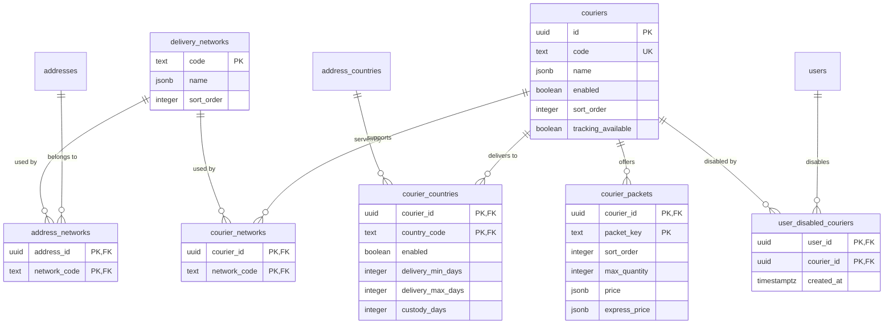

# Couriers & delivery networks

Added by `1738000009000_courier.js`. Addresses aren't a simple home/relay
boolean: distinct pickup-point networks (a Mondial Relay point, a generic
relay/collection-point service, ...) are mutually incompatible with each
other, so `delivery_networks` exists as its own table — and an address can
belong to **more than one** network at once (`address_networks`, a
many-to-many, not a single column): a physical pickup point can genuinely
be registered with more than one network (e.g. a shop hosting both a
Mondial Relay locker and a generic relay counter). Every courier declares
which network(s) it accepts (also many-to-many) — a courier and an address
are compatible whenever their network sets share **at least one** code in
common (`networksOverlap()` in `couriers.service.ts`; `confirmOrder` runs
the equivalent as a SQL join). This is also how two couriers both
delivering to the same home address falls out naturally (they simply both
list `home`).

`delivery_networks` is an **open** vocabulary, same pattern as the gallery
library's `shapes`/`colors` tables — authored in
`catalog source/courier/data-networks.json` and upserted through
`POST /operation/courier-import/networks` (`upsertNetworks()`), not
hand-seeded in the migration; the table starts empty. Couriers themselves
are authored as JSON in `catalog source/courier/<code>.json`, referencing
networks by `"$key"` (same convention as a gallery set's `"$shapeKey"`
referencing `data-common.json`), and pushed via `npm run courier` (same
idempotent-import pattern as `npm run library`, see
`courierImport.routes.ts` / `scripts/courier.ts`).

### `delivery_networks`

| Column       | Type               | Notes                                                                                                                      |
| ------------ | ------------------ | -------------------------------------------------------------------------------------------------------------------------- |
| `code`       | `text` PK          | `'home'`, `'mondial-relay-point'`, `'pickup-relay'`, ... — whatever `catalog source/courier/data-networks.json` defines. |
| `name`       | `jsonb not null`   | Trilingual label, same shape as `address_countries.label`.                                                                 |
| `sort_order` | `integer not null` | Object-key order from `data-networks.json`; it selects the matched network snapshot when several overlap.                  |

Open vocabulary (unlike `address_countries`, which is closed/migration-
seeded) — adding a new network is a `data-networks.json` edit plus
referencing it from a courier's `networks` array, no backend code change
needed, same as adding a color to the gallery library. A network isn't
owned by one courier: `home` is shared by every home-delivering courier,
and a generic pickup/relay network can be shared by more than one courier
too, as opposed to one that's a specific provider's own proprietary
network.

`npm run courier -- seed --update --delete` treats this source file as
authoritative: networks removed from it are deleted. That deletion cascades
through `courier_networks` and `address_networks`; it sets an existing
`orders.network_code` to null so the historical order remains valid.

### `couriers`

| Column       | Type                            | Notes                                                                                                                                                                                                          |
| ------------ | ------------------------------- | -------------------------------------------------------------------------------------------------------------------------------------------------------------------------------------------------------------- |
| `id`         | `uuid` PK                       | App-generated.                                                                                                                                                                                                 |
| `code`       | `text not null unique`          | Natural key — the `code` field inside `catalog source/courier/<file>.json`, not the filename.                                                                                                                |
| `name`       | `jsonb not null`                | Trilingual, same shape as a gallery set's `title` — a courier's display name can differ by language (usually won't, but nothing forces it not to).                                                             |
| `enabled`    | `boolean not null default true` | The **only** on/off switch — toggling a whole courier off without deleting its data. There's deliberately no per-packet-tier flag: a tier's presence in `courier_packets` (below) is its own "offered" signal. |
| `sort_order` | `integer not null default 0`    | Display order at checkout.                                                                                                                                                                                     |
| `tracking_available` | `boolean not null default false` | Added by `1738000026000_courier_tracking_available.js`. Catalog-level "can a customer track this courier's shipments" flag, authored as `trackingAvailable` in `catalog source/courier/<code>.json`. Read live off `orders.courier_code` for the orders API (not snapshotted onto the order), and doesn't by itself guarantee tracking works — `shippingTracking.service.ts`'s `resolveTrackingProvider` still has to recognize the courier's code before `GET /account/orders/:id/tracking` can actually fetch anything. |
| `description` | `jsonb not null default '{}'::jsonb` | Optional multilingual customer-facing sentence authored as `description` in `catalog source/courier/<code>.json`; shown under the courier name in checkout. Added by `1787280000000_courier_description.js`. |

### `courier_countries` / `courier_networks` / `address_networks`

Plain many-to-many join tables (composite PK, no surrogate id).
`courier_countries`/`courier_networks`: which `address_countries`/
`delivery_networks` a courier serves. `address_networks`: which network(s)
a given address belongs to (see this section's intro on why this isn't a
single column) — only ever populated for a `kind='livraison'` address; a
`kind='facturation'` one has no rows here at all, since it's never matched
against a courier. `confirmOrder` checks country equality (and
`courier_countries.enabled`) and network overlap against the chosen address
before allowing a courier (`courier_country_unavailable` /
`courier_network_unavailable`); among any network overlap, the one with the
lowest `delivery_networks.sort_order` is what gets snapshotted onto the
order (`orders.network_code`, singular — see below), together with that
network's optional pickup/locker reference (`orders.pickup_point`).

`courier_countries.enabled` (added by
`1787450000000_courier_country_enabled_packet_prices.js`, default `true`)
is the live per-country open/closed switch for that courier — independent of
`address_countries.enabled` (home typing) and of `couriers.enabled`
(shop-wide). Admin shipping-catalog PATCH and courier seed both write it.
`GET /account/couriers` returns enabled codes in `countries` and the full
`{code,enabled}[]` as optional `catalogCountries`.

`courier_countries` also carries the per-country delivery estimate added by
`1738000002300_courier_delivery_time.js` — `delivery_min_days` /
`delivery_max_days` (set together or both null,
`courier_countries_delivery_range_ck`) and `custody_days`, all authored in
`catalog source/courier/<code>.json` as `deliveryTime` / `custodyTime`
(scalar, country map, or `{ "default": …, …overrides }`). They live here
rather than on `couriers` because the same courier quotes 3-5 days to FR
and 3-6 to BE. Presentational only — nothing in checkout validates against
them; `custody_days` is how long a pickup point holds a parcel before
returning it, so it's null for home delivery (key omitted) and for
countries left out of a listed-only `custodyTime` map. Import requires a
delivery window for every catalogued courier country; packet prices use the
same coverage rule. Exposed per-country by `GET /account/couriers` and
shown under the courier's name on the cart page.

### `courier_packets`

Free-form, per-courier ordered list of "packet" tiers — not a global enum,
since different couriers can offer different tiers (a 2-tier courier and a
4-tier courier both fit this same table).

| Column                    | Type                                        | Notes                                                                                                                                                                                                                                                                                              |
| ------------------------- | ------------------------------------------- | -------------------------------------------------------------------------------------------------------------------------------------------------------------------------------------------------------------------------------------------------------------------------------------------------- |
| `packet_key`              | `text`                                      | Part of the PK `(courier_id, packet_key)`. Internal only, never shown to the customer.                                                                                                                                                                                                             |
| `sort_order`              | `integer not null`                          | Ascending = smallest capacity first, mirrors the JSON array order in `courier/<code>.json`.                                                                                                                                                                                                        |
| `max_quantity`            | `integer not null check (max_quantity > 0)` | Customer-added **nail-set** quantity this tier can hold. Accessories and rule-generated gift lines count as 0 (they ride in the parcel without bumping the tier). Packet size is **never a customer choice** — `confirmOrder` walks tiers in `sort_order` and picks the first whose `max_quantity` covers that nail quantity; exceeding every tier blocks checkout (`shipping_overflow`), no auto-split. An accessories-only cart (nail quantity 0) still fits the smallest tier. |
| `price` / `express_price` | `jsonb`                                     | Added as jsonb by `1787450000000_courier_country_enabled_packet_prices.js` (was `numeric`). Manager authoring accepts a scalar, a country map, or `{ "default": N, …overrides }` (expanded at import). Stored as a JSON number when uniform across every catalogued country, otherwise an object mapping ISO country code → positive number (partial maps allowed — countries without an entry cannot be enabled). `express_price` is `null` when this tier doesn't offer express — its presence is the "offers express" signal, no separate flag. Checkout resolves the fee for the delivery address's country (`shipping_price_unavailable` / `express_unavailable` when missing). |

Index: `courier_packets_courier_idx (courier_id, sort_order)`.

### `shipping_packet_measurements`

Global physical parcel measurements imported from
`catalog source/courier/data-packet.json` (`1787280000001_shipping_packet_measurements.js`).
`quantity` is the exact total of customer-added nail creations (accessories
and gifts excluded); `weight` is grams and `length`/`width`/`depth` are
centimetres. Public gift `GET /gift/settings.maxSetsCeiling` is `max(quantity)` from this
table (packed-nail ceiling, unused for `POST /gift/offers`). The admin dispatch action resolves this row server-side before
creating a carrier label, so the browser never asks an administrator to enter
packing measurements and the runtime never reads the manager repository.
Couriers without an automated label adapter (for example `chronopost-home`,
`colissimo-home`)
skip label generation entirely at `to_send`; ops records the shipment number
later with `npm run order -- set-tracking`.

| Column | Type | Notes |
| --- | --- | --- |
| `quantity` | `integer` PK | Exact nail-creation count; `> 0` |
| `weight` | `integer not null` | Grams; `> 0` |
| `length` / `width` / `depth` | `integer not null` | Centimetres; each `> 0` |

Constraint `shipping_packet_measurements_positive_chk`: all columns must be `> 0`.

### `user_disabled_couriers`

Per-customer opt-out of a specific courier (account/addresses page's courier tiles) — independent of `couriers.enabled` above, which is the shop-wide on/off switch. Affects cart/address UI only (primary vs overflow list); checkout still accepts an explicit customer choice, including from overflow. Only shop-wide `couriers.enabled` and per-country `courier_countries.enabled` block pricing/reservation. No surrogate `id`: PK is `(user_id, courier_id)`, and row **presence = disabled** — no row means enabled, so an account created before this feature existed sees every courier enabled by default without a backfill. Disabling a courier that's currently the customer's default courier (`user_preference` key `default_courier_code`) also clears that default, same handling as disabling PayPal while it's the default payment method.

FK `courier_id` references `couriers(id) on delete cascade`.

Index: `user_disabled_couriers_user_idx (user_id)`.
